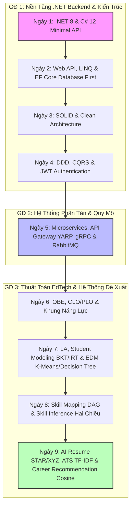

# 🎯 CẨM NANG NGHIÊN CỨU & KẾ HOẠCH TRIỂN KHAI DỰ ÁN (MASTER PLAN & SKILLS GUIDE)
*Hồ sơ theo dõi kỹ năng, lý thuyết thuật toán, và lộ trình thực thi dự án "AI Generate CV"*

---

> [!IMPORTANT]
> **SỔ TAY HƯỚNG DẪN THỰC THI THỐNG NHẤT**
> Tài liệu này được biên soạn bằng cách tích hợp toàn bộ các kết quả nghiên cứu lý thuyết (18/06 - 30/06), các công thức thuật toán EdTech/AI cốt lõi, và kế hoạch chi tiết xây dựng Web API dự án `generatecv` để bạn dễ dàng theo dõi, ôn tập và triển khai thực tế.

---

## 🗺️ PHẦN 1: BẢN ĐỒ KỸ NĂNG & TIẾN ĐỘ NGHIÊN CỨU (18/06 - 30/06)

### 1. Bảng Thống Kê Tiến Độ & Demo Project
Dưới đây là tiến trình kỹ năng bạn đã tích lũy và các sản phẩm chạy thử nghiệm (Demo) tương ứng:

| Ngày | Chủ đề Nghiên cứu (Keywords) | Sản phẩm Thực hành (Demo Project) | Cổng Chạy (Ports) | Trạng thái |
| :--- | :--- | :--- | :--- | :--- |
| **18/06** | .NET 8, C# 12, CLR, JIT/AOT, Primary Constructors, Keyed DI | **DemoApi** (Minimal API) | `8080` | Đã xong |
| **19/06** | Controller Web API, LINQ (Deferred vs Immediate), EF Core DB First, Transactions | **E-Commerce API** | `8080` (SQLite mount) | Đã xong |
| **22/06** | SOLID Principles, Clean Architecture, MediatR CQRS, FluentValidation | **Book Store API** | `8080` | Đã xong |
| **23/06** | Domain-Driven Design (DDD), JWT Authentication, Domain Events Dispatching | **Advanced Book Store API** | `8080` | Đã xong |
| **24/06** | Microservices, API Gateway YARP, gRPC, RabbitMQ + MassTransit | **Microservices Demo System** | `8080` (Gateway), `8081` (Order), `8082` (Inventory), `15672` (MQ) | Đã xong |
| **25/06** | OBE (Outcome-Based Education), CLO/PLO, Bloom's Taxonomy, Remediation Plan | **ObeEvaluationSystem** | `8080` | Đã xong |
| **26/06** | Learning Analytics, BKT, IRT (2PL Model), EDM (K-Means, Decision Tree) | **SmartLearningAnalyticsSystem** | `8080` (Sandbox Simulator) | Đã xong |
| **29/06** | Skill Mapping (DAG Graph), Skill Inference (Forward/Backward Propagation) | **Simple Console Competency** | Console (Docker) | Đã xong |
| **30/06** | AI Resume (STAR, Google XYZ), ATS Audit (TF-IDF), Career Recommendation | **Console Resume & Career Engine** | Console (Docker output HTML) | Đã xong |

### 2. Mô hình hóa Lộ trình Nghiên cứu


---

## 🧮 PHẦN 2: TỔNG HỢP CÔNG THỨC TOÁN HỌC & THUẬT TOÁN EDTECH/AI

### 1. Outcome-Based Education (OBE)
*   **Độ Đạt CLO (CLO Attainment):**
    $$\text{CLO Attainment (\%)} = \frac{\sum \text{Điểm đạt được của SV cho các câu hỏi thuộc CLO}}{\sum \text{Điểm tối đa của các câu hỏi thuộc CLO}} \times 100$$
    *(Ngưỡng đạt chuẩn thông thường: $\ge 50\%$)*

*   **Độ Đạt PLO (PLO Attainment):** Trung bình có trọng số của các CLO ánh xạ vào PLO đó:
    $$\text{PLO Attainment (\%)} = \frac{\sum (\text{CLO Attainment} \times \text{WeightInPlo})}{\sum \text{WeightInPlo}}$$
    *(Ngưỡng đạt chuẩn chương trình: $\ge 60\%$)*

*   **Phân loại Năng lực (Competency Level):**
    *   **Mastery (Thành thục):** Điểm PLO $\ge 75\%$
    *   **Developing (Đang phát triển):** $50\% \le$ Điểm PLO $< 75\%$
    *   **Beginning (Mới bắt đầu):** Điểm PLO $< 50\%$ $\rightarrow$ Kích hoạt kế hoạch cải thiện (**Remediation Plan**).

### 2. Bayesian Knowledge Tracing (BKT)
BKT sử dụng mô hình Hidden Markov Model (HMM) để theo dõi xác suất sinh viên làm chủ kỹ năng ẩn $P(L_t)$ sau mỗi lượt tương tác (Làm Đúng / Sai):
*   **Các tham số cơ bản:**
    *   $P(L_0)$: Xác suất ban đầu đã hiểu/làm chủ kỹ năng.
    *   $P(T)$: Xác suất học được kỹ năng mới sau mỗi lượt thử.
    *   $P(G)$: Xác suất đoán mò đúng dù chưa làm chủ kỹ năng (Guess).
    *   $P(S)$: Xác suất sơ suất làm sai dù đã làm chủ kỹ năng (Slip).

*   **Bước 1: Cập nhật xác suất có điều kiện (Posterior) dựa trên hành động thực tế:**
    *   Nếu học viên làm **Đúng** câu hỏi:
        $$P(L_{t-1} | Correct) = \frac{P(L_{t-1}) \cdot (1 - P(S))}{P(L_{t-1}) \cdot (1 - P(S)) + (1 - P(L_{t-1})) \cdot P(G)}$$
    *   Nếu học viên làm **Sai** câu hỏi:
        $$P(L_{t-1} | Incorrect) = \frac{P(L_{t-1}) \cdot P(S)}{P(L_{t-1}) \cdot P(S) + (1 - P(L_{t-1})) \cdot (1 - P(G))}$$

*   **Bước 2: Dự báo trạng thái tri thức cho lượt tiếp theo (Transition):**
    $$P(L_t) = P(L_{t-1} | Action) + (1 - P(L_{t-1} | Action)) \cdot P(T)$$

### 3. Item Response Theory (IRT) - Mô hình 2PL
Tính xác suất một sinh viên có năng lực tiềm ẩn $\theta$ làm đúng một câu hỏi có độ khó $b$ và độ phân biệt $a$:
$$P(X = 1 | \theta, a, b) = \frac{1}{1 + e^{-a(\theta - b)}}$$
*   $\theta$: Năng lực học tập của sinh viên (thường chuẩn hóa từ $-3.0$ đến $+3.0$).
*   $b$: Độ khó của câu hỏi (câu hỏi càng khó, sinh viên cần $\theta$ càng cao để làm đúng).
*   $a$: Độ phân biệt của câu hỏi (khả năng phân tách nhóm giỏi và nhóm yếu).

### 4. Đồ thị kỹ năng DAG & Suy luận ẩn hai chiều (Skill Inference Engine)
Bản đồ kỹ năng được tổ chức dưới dạng Đồ thị có hướng không chu trình (DAG - Directed Acyclic Graph).

```text
Forward Propagation (Suy luận tiến: Tiền quyết -> Nâng cao)
      [Basics: SK-001] ───► [OOP: SK-002] ───► [API Dev: SK-003]
                                                   │
Backward Propagation (Suy luận lùi: Nâng cao -> Tiền quyết) (Confidence x Weight)
```

#### A. Lan truyền tiến (Forward Propagation)
Dự báo khả năng sẵn sàng học kỹ năng nâng cao dựa trên điểm các môn cơ bản đã học trước đó:
$$\text{ForwardInferred}(Skill_{Advanced}) = \text{Average}(\text{CombinedMastery của các Parent}) \times 0.85$$

#### B. Lan truyền lùi (Backward Propagation)
Nếu làm tốt bài thi của kỹ năng nâng cao (phức tạp), hệ thống tự động suy luận ngược lại rằng học viên đã làm chủ các kỹ năng nền tảng bên dưới:
$$\text{BackwardInferred}(Skill_{Prereq}) = \max_{c \in Children} \left( \text{CombinedMastery}(c) \times \text{Weight}_c \right)$$

#### C. Hợp nhất năng lực (Mastery Fusion)
Dung hòa giữa điểm thực tế đánh giá trực tiếp (`DirectMastery`) và điểm suy luận (`InferredMastery`) thông qua trọng số tin cậy $\alpha$:
$$\text{CombinedMastery} = (\alpha \times \text{DirectMastery}) + ((1.0 - \alpha) \times \text{InferredMastery})$$
*   Đã thi trực tiếp nút kỹ năng đó: $\alpha = 1.0$ (tin hoàn toàn điểm thi).
*   Chưa thi trực tiếp: $\alpha = 0.0$ (lấy hoàn toàn từ điểm suy luận đồ thị).

#### D. Code triển khai suy luận hội tụ (C#)
```csharp
// Chạy 3 vòng lặp để lan truyền điểm hội tụ trên đồ thị DAG
for (int iter = 0; iter < 3; iter++)
{
    foreach (var sk in skills)
    {
        double fwdInferred = 0.0;
        double bwdInferred = 0.0;

        // 1. Lan truyền tiến: Tiền quyết -> Nâng cao
        var parents = prerequisites.Where(p => p.ChildCode == sk.Code).ToList();
        if (parents.Any())
        {
            fwdInferred = parents.Average(p => skillStates[p.ParentCode].CombinedMastery) * 0.85;
        }

        // 2. Lan truyền lùi: Nâng cao -> Tiền quyết
        var children = prerequisites.Where(p => p.ParentCode == sk.Code).ToList();
        if (children.Any())
        {
            bwdInferred = children.Max(c => skillStates[c.ChildCode].CombinedMastery * c.Weight);
        }

        // 3. Chọn điểm suy luận tốt nhất và hợp nhất dựa trên độ tin cậy
        double inferred = Math.Max(fwdInferred, bwdInferred);
        skillStates[sk.Code].InferredMastery = inferred;

        double alpha = skillStates[sk.Code].Confidence;
        skillStates[sk.Code].CombinedMastery = (alpha * skillStates[sk.Code].DirectMastery) + ((1.0 - alpha) * inferred);
    }
}
```

### 5. Ánh xạ Năng lực & Đề xuất Nghề nghiệp (Cosine Similarity)
*   **Ánh xạ điểm học thuật sang Vector Kỹ năng công việc (8 chiều):**
    $$\text{CompetencyScore}(Comp_j) = \frac{\sum_{i} \text{Grade}(Course_i) \times \text{Weight}_{ij}}{\sum_{i} \text{Weight}_{ij}}$$
*   **Đề xuất nghề nghiệp bằng Cosine Similarity:**
    So khớp Vector năng lực học viên ($\vec{A}$) với Vector yêu cầu công việc ($\vec{B}$):
    $$\text{Cosine Similarity} = \frac{\vec{A} \cdot \vec{B}}{\|\vec{A}\| \|\vec{B}\|} = \frac{\sum A_i B_i}{\sqrt{\sum A_i^2} \sqrt{\sum B_i^2}}$$
*   **Phân tích khoảng cách kỹ năng (Skill Gaps):**
    $$\text{SkillGap}_i = \max(0, \text{Required}_i - \text{Student}_i)$$

### 6. Đánh giá tương thích ATS bằng thuật toán TF-IDF tự viết
*   **Tính Term Frequency (TF):**
    $$TF(t) = \frac{\text{Số lần xuất hiện của từ } t \text{ trong JD}}{\text{Tổng số từ trong JD}}$$
*   **Tính Inverse Document Frequency (IDF):**
    $$IDF(t) = \ln\left(\frac{N\_docs}{DF(t)}\right)$$
    *(Với $N\_docs$ là tổng số văn bản trong corpus, $DF(t)$ là số văn bản chứa từ $t$)*
*   **Chỉ số TF-IDF:** $TF(t) \times IDF(t)$. Top 6-8 từ khóa có TF-IDF cao nhất được dùng làm tập từ khóa chính để kiểm tra độ phủ (Match Score) trong CV.

#### Python Code trích xuất TF-IDF cốt lõi:
```python
def extract_tfidf_keywords(jd: str, corpus: List[str], top_n: int = 8) -> List[str]:
    # 1. Tách từ và lọc stopwords
    jd_words = [w for w in clean_and_tokenize(jd) if w not in STOPWORDS]
    if not jd_words: return []
    
    # 2. Tính TF
    tf = {}
    for w in jd_words:
        tf[w] = tf.get(w, 0) + 1
        
    # 3. Tính DF
    df = {}
    all_docs = corpus + [jd]
    for doc in all_docs:
        doc_words = set(clean_and_tokenize(doc))
        for w in tf:
            if w in doc_words:
                df[w] = df.get(w, 0) + 1
                
    # 4. Tính toán TF-IDF
    tfidf = {}
    n_docs = len(all_docs)
    for w, freq in tf.items():
        doc_freq = df.get(w, 1)
        idf = math.log(n_docs / doc_freq)
        tfidf[w] = (freq / len(jd_words)) * idf
        
    # 5. Lấy Top từ khóa
    sorted_kws = sorted(tfidf.items(), key=lambda x: x[1], reverse=True)
    return [kw for kw, score in sorted_kws[:top_n]]
```

### 7. Tối ưu hóa CV chuẩn Google XYZ & STAR
*   **Công thức Google XYZ:** *Accomplished [X] as measured by [Y], by doing [Z]* (Đạt được kết quả X, đo lường bằng Y, thông qua hành động Z).
*   **Ví dụ ứng dụng:**
    *   *Mô tả thô:* "I was responsible for writing backend endpoints and speeding up query search times."
    *   *Chuẩn XYZ:* "**Optimized** and deployed backend endpoints and speeding up query search times utilizing **FastAPI endpoints and SQL indexing**, achieving a **35% faster query response time**."

---

## 🛠️ PHẦN 3: KẾ HOẠCH PHÁT TRIỂN BACKEND & HỢP TÁC GIT (DỰ ÁN: generatecv)

Phần này phân chia rõ ràng công việc của **Toàn** và **Hải** trên dự án API C# kết nối DB SQL Server thực tế thông qua Docker.

### 1. Thiết Lập Database & Khôi Phục (Restore) dữ liệu
Để tránh xung đột, **Toàn** sẽ dựng baseline này trước và đẩy lên Git `main`.

#### File `docker-compose.yml` (đặt tại thư mục gốc dự án):
```yaml
version: '3.8'

services:
  db:
    image: mcr.microsoft.com/mssql/server:2022-latest
    container_name: sqlserver_generatecv
    environment:
      - ACCEPT_EULA=Y
      - MSSQL_SA_PASSWORD=YourSecurePassword123!
    ports:
      - "1433:1433"
    volumes:
      - ./TayDoV2.bak:/var/opt/mssql/backup/TayDoV2.bak
      - sqlserver_data:/var/opt/mssql/data
    restart: always

volumes:
  sqlserver_data:
```

#### Các lệnh khôi phục cơ sở dữ liệu:
```bash
# Khởi động container
docker compose up -d

# Bước A: Kiểm tra danh sách file logic trong file backup (.bak)
docker exec -it sqlserver_generatecv /opt/mssql-tools/bin/sqlcmd \
  -S localhost -U sa -P "YourSecurePassword123!" \
  -Q "RESTORE FILELISTONLY FROM DISK = '/var/opt/mssql/backup/TayDoV2.bak'"

# Bước B: Thực hiện Restore database TayDoV2
docker exec -it sqlserver_generatecv /opt/mssql-tools/bin/sqlcmd \
  -S localhost -U sa -P "YourSecurePassword123!" \
  -Q "RESTORE DATABASE TayDoV2 FROM DISK = '/var/opt/mssql/backup/TayDoV2.bak' WITH MOVE 'TayDoV2' TO '/var/opt/mssql/data/TayDoV2.mdf', MOVE 'TayDoV2_log' TO '/var/opt/mssql/data/TayDoV2_log.ldf'"
```

### 2. Scaffold DBContext (Database-First)
Tạo dự án Web API ASP.NET Core 8, thêm các package EF Core cần thiết:
```bash
dotnet add package Microsoft.EntityFrameworkCore.SqlServer
dotnet add package Microsoft.EntityFrameworkCore.Design
dotnet add package Microsoft.EntityFrameworkCore.Tools
```

Chạy lệnh scaffold tự động sinh Entities & DbContext:
```bash
dotnet ef dbcontext scaffold "Server=localhost,1433;Database=TayDoV2;User Id=sa;Password=YourSecurePassword123!;TrustServerCertificate=True" Microsoft.EntityFrameworkCore.SqlServer -o Models -d
```

---

### 3. Phân Chia Tính Năng Phát Triển (Tránh Xung Đột Code)

#### Nhánh 1 (Toàn): `feature/auth-and-profile`
*   **Mục tiêu:** Xử lý xác thực người dùng, JWT token và quản lý kỹ năng cá nhân.
*   **API viết mới:**
    1.  **Authentication API:** Đăng ký, Đăng nhập, JWT Token generation.
    2.  **User Profile API:** Lấy thông tin ứng viên (GET), cập nhật thông tin liên hệ (PUT).
    3.  **Skill & Competency API:** CRUD kỹ năng cá nhân (áp dụng thuật toán suy luận kỹ năng).
*   **Các file tạo mới (Không lo conflict):**
    *   `AuthController.cs`, `ProfileController.cs`, `SkillController.cs`
    *   `AuthService.cs`, `ProfileService.cs`, `SkillService.cs`
    *   DTOs liên quan đến Auth & Profile.

#### Nhánh 2 (Hải): `feature/cv-and-sections`
*   **Mục tiêu:** Quản lý thông tin chi tiết cấu trúc CV của ứng viên.
*   **API viết mới:**
    1.  **Resume Metadata API:** CRUD thông tin cơ bản của CV (Tiêu đề, chọn Template).
    2.  **Work Experience API:** CRUD lịch sử làm việc (Tên công ty, vai trò, mô tả STAR).
    3.  **Education API:** CRUD học vấn (Trường học, ngành học, GPA).
    4.  **Projects & Certificates API:** CRUD dự án cá nhân & chứng chỉ đạt được.
*   **Các file tạo mới (Không lo conflict):**
    *   `ResumeController.cs`, `ExperienceController.cs`, `EducationController.cs`
    *   `ResumeService.cs`, `ExperienceService.cs`, `EducationService.cs`
    *   DTOs liên quan đến CV, Experience, Education.

---

### 4. Quy Tắc Git & Code Chung (Tránh Conflict)
1.  **Không chỉnh sửa file Models đã scaffold:** Nếu cần sửa schema database, hai bên phải thảo luận trước rồi chạy lại lệnh scaffold.
2.  **Đăng ký DI thông minh (Dependency Injection):**
    *   Viết Extension Method riêng cho từng nhánh để đăng ký Service.
    *   *Toàn viết:* `DependencyInjection.AddAuthServices()`
    *   *Hải viết:* `DependencyInjection.AddResumeServices()`
    *   Trong `Program.cs` chỉ gọi các phương thức này, giúp giảm thiểu thay đổi trực tiếp trên cùng một dòng trong `Program.cs`.
3.  **Quy trình hợp nhất code (Merge Workflow):**
    *   Khi Toàn xong nhánh `feature/auth-and-profile` $\rightarrow$ Tạo **Pull Request (PR)** vào `main`.
    *   Hải review code $\rightarrow$ Nhấn **Merge**.
    *   Ngay sau đó, Hải chạy các lệnh sau trên máy mình để đồng bộ:
        ```bash
        git checkout main
        git pull origin main
        git checkout feature/cv-and-sections
        git merge main
        ```
    *   Hải giải quyết các xung đột nhỏ (nếu có) trên máy local, kiểm tra dự án chạy ổn định rồi mới tiếp tục code.

---

### 5. Lộ Trình Triển Khai Chi Tiết Tuần Này (Web API)

| Ngày | Công việc của Toàn (`feature/auth-and-profile`) | Công việc của Hải (`feature/cv-and-sections`) |
| :--- | :--- | :--- |
| **Thứ 2 - Thứ 3** | Thiết lập DB Docker, Scaffold Models, đăng ký DbContext, đẩy baseline lên nhánh `main`. Hoàn thành API Register/Login & JWT. | Pull baseline từ `main` về local. Thiết kế cấu trúc DTOs và API CRUD cho thực thể Resume (CV chính). |
| **Thứ 4 - Thứ 5** | Viết API lấy và cập nhật hồ sơ cá nhân Candidate (Avatar, liên hệ...). Viết các API CRUD Skills. | Viết các API CRUD cho Work Experience, Education. |
| **Thứ 6** | Tích hợp JWT Middleware bảo mật các endpoint. Viết unit test / test bằng Postman. | Viết API CRUD cho Projects & Certificates. Test endpoint bằng Swagger/Postman. |
| **Thứ 7** | Tạo PR đưa nhánh `feature/auth-and-profile` vào `main`. | Pull `main` đã merge của Toàn về, gộp vào nhánh của Hải, test tích hợp toàn diện rồi merge nhánh của Hải vào `main`. |
| **Chủ Nhật** | Cả hai cùng review lại hệ thống API đã chạy mượt mà, chuẩn bị tài liệu API cho tuần sau làm UI & Generate Engine. |

---

## 🚀 PHẦN 4: HƯỚNG DẪN KHỞI CHẠY NHANH CÁC DỰ ÁN DEMO (DOCKER)

Trước khi khởi chạy dự án của ngày mới, hãy nhớ tắt container của ngày cũ để tránh trùng cổng bằng lệnh:
```bash
docker compose down   # Trong thư mục dự án cũ
# Hoặc dừng toàn bộ container đang chạy:
docker stop $(docker ps -aq)
```

```bash
# === NGÀY 18/06: Minimal API ===
cd dotnet-learning_18-6/DemoApi/
chmod +x start.sh && ./start.sh

# === NGÀY 19/06: E-Commerce Web API ===
cd aspdotnet-learning_19-6/
docker compose up --build -d

# === NGÀY 22/06: Book Store API (Clean Arch) ===
cd learning_22-6/
docker compose up -d

# === NGÀY 23/06: Advanced Book Store API (DDD) ===
cd learning_23-6/
docker compose up --build -d

# === NGÀY 24/06: Microservices (YARP, gRPC, RabbitMQ) ===
cd learning_24-6/
docker compose up --build -d
# URL RabbitMQ Management: http://localhost:15672 (guest/guest)

# === NGÀY 25/06: OBE Evaluation System ===
cd learning_25-6/src/
docker compose up --build -d

# === NGÀY 26/06: Smart Learning Analytics System (BKT/IRT) ===
cd learning_26-6/src/
docker compose up --build -d

# === NGÀY 29/06: Skill Inference (C# Console Demo) ===
cd learning_29-6/src/
docker compose up --build simple-console-demo

# === NGÀY 30/06: AI Resume & Career Recommendation (Python Console) ===
cd learning_30-6/
docker compose up --build simple-resume-demo
```

---

## 📝 PHẦN 5: QUY CHUẨN BÁO CÁO HẰNG NGÀY (DAILY REPORT TEMPLATE)
Mỗi ngày trước **17h00**, gửi báo cáo theo mẫu sau kèm link tài liệu research:

```text
[Daily report - DD/MM/2026]
- Họ tên: Trà Đức Toàn
- Nội dung nghiên cứu hôm nay: [Tên keyword / Tính năng đang làm]
- Tiến độ tự đánh giá: [Đã hoàn thành / Đang làm %]
- Issue: [None / Mô tả lỗi gặp phải và hướng xử lý]
- Link Git/Drive: [Đường dẫn đính kèm]
```
