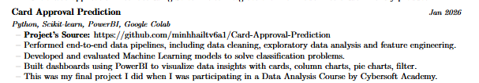

1. Zoom-in, Zoom-out by notepad
2. Layout của chứng chỉ, bằng cấp bị lỗi
3. Format lại dự án cá nhân như ví dụ sau:
   
4. Remove kết quả môn học tiêu biểu khỏi cv
5. Thêm lựa chọn tiếng anh tiếng việt
6. Nên ghép Ngoại ngữ vào chung bằng cấp
7. Chỉnh phần xuất file pdf, đang bị lỗi layout
8. Kiểm tra lại phần tạo ra trang mới khi trang hiện tại của cv bị đầy, em làm ra rồi nhưng nó bị dư một khoảng khá lớn ở trang cũ
