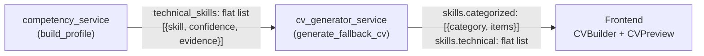
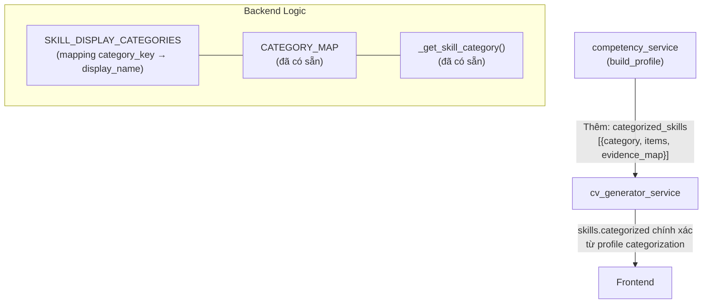

# 🎯 Phân Tích & Giải Pháp: Nhóm Kỹ Năng Kỹ Thuật (Categorized Competences)

## Vấn Đề Hiện Tại

Phần **"Kỹ năng kỹ thuật"** trong CV hiện chỉ liệt kê phẳng tên các kỹ năng (flat list), ví dụ:

```
Docker, Kubernetes, Python, Bash, AWS, PostgreSQL, Terraform, Git, CI/CD, Linux
```

Mong muốn đầu ra giống CV chuyên nghiệp:

```
COMPETENCES
* Backend & Programming Skills: Python, Bash, Java.
* Databases & Data Management: PostgreSQL, MySQL.
* DevOps, Tools & Infrastructure: Docker, Kubernetes, AWS, Terraform, CI/CD, Git.
* Domain Knowledge: Core Banking, Kafka, Infrastructure as Code.
* Soft Skills & Methodologies: Agile Scrum, Technical Troubleshooting, Cross-functional Collaboration.
```

---

## Phân Tích Codebase Hiện Tại

### Dữ liệu chảy qua 3 lớp:



### Lớp 1: `competency_service.py` → Chỉ output flat list

[competency_service.py dòng 272-290](file:///D:/CaoDangTayDo_Intern/generate_cv/generate-cv2026/ai-service/app/services/competency_service.py#L272-L290):

```python
technical_summary.append({
    "skill": skill,
    "confidence": conf_score,
    "evidence": evidences,
})
```

Output `technical_skills` là flat list `[{skill, confidence, evidence}]` — **không có thông tin category**.

Tuy nhiên, `CATEGORY_MAP` đã tồn tại (dòng 52-58) và hàm `_get_skill_category()` (dòng 104-111) đã có sẵn logic xác định category cho mỗi skill. **Chưa được tận dụng cho output cuối.**

### Lớp 2: `cv_generator_service.py` → Categorization bằng keyword matching thô

[cv_generator_service.py dòng 139-148](file:///D:/CaoDangTayDo_Intern/generate_cv/generate-cv2026/ai-service/app/services/cv_generator_service.py#L139-L148):

```python
"categorized": [
    {"category": "Backend & Programming Skills", 
     "items": [s for s in tech_skills if not any(kw in s.lower() for kw in ['sql', 'postgres', ...])] or tech_skills},
    {"category": "Databases & Data Management", 
     "items": [s for s in tech_skills if any(kw in s.lower() for kw in ['sql', 'postgres', ...])] or ["PostgreSQL", "MySQL"]},
    ...
]
```

**Vấn đề:**
- Logic phân nhóm bằng keyword matching **thô và cứng** — hardcode danh sách keywords cho mỗi category
- **Không tái sử dụng** `CATEGORY_MAP` và `SKILL_SYNONYMS` đã có trong `competency_service`
- Nhánh `or tech_skills` / `or ["PostgreSQL", "MySQL"]` tạo ra **dữ liệu giả** khi không match → nguy hiểm
- Không hỗ trợ thêm category mới (ví dụ: "Domain Knowledge", "Infrastructure & Monitoring")
- Kỹ năng có thể **rơi nhầm nhóm** hoặc **bị lặp** giữa các nhóm

### Lớp 3: Frontend `CVPreview.tsx` → Fallback categorization cũng bằng keyword thô

[CVPreview.tsx dòng 6-35](file:///D:/CaoDangTayDo_Intern/generate_cv/generate-cv2026/frontend/src/components/CVPreview.tsx#L6-L35):

```typescript
const getFormattedSkillGroups = (cvData: CVData): CategorizedSkillGroup[] => {
  if (cvData.categorizedSkills?.length > 0) return cvData.categorizedSkills;
  // ... fallback: cùng logic keyword matching thô
};
```

Frontend có hàm backup phân nhóm nếu backend không gửi `categorizedSkills`, nhưng cũng dùng keyword matching tương tự → cùng vấn đề.

### Lớp 4: LLM Prompt `prompts.py` → Đã có schema đúng nhưng LLM bị ground lại

[prompts.py dòng 52-62](file:///D:/CaoDangTayDo_Intern/generate_cv/generate-cv2026/ai-service/app/models/prompts.py#L52-L62):

Schema trong prompt đã yêu cầu `skills.categorized` đúng format, **nhưng** hàm `_ground_cv_in_profile()` ghi đè toàn bộ CV bằng fallback engine → mất kết quả LLM categorization.

---

## Giải Pháp Đề Xuất

### Tổng quan kiến trúc mới:



### Task 1: Thêm `categorized_skills` vào output của `competency_service.py`

**File:** `ai-service/app/services/competency_service.py`

Thêm mapping display name và method mới:

```python
# Mapping internal category keys → display names cho CV
SKILL_DISPLAY_CATEGORIES: Dict[str, str] = {
    "web_frontend": "Frontend & UI Development",
    "web_backend": "Backend & Programming Skills",
    "database": "Databases & Data Management",
    "devops_cloud": "DevOps, Tools & Infrastructure",
    "ai_data": "AI, Data Science & Machine Learning",
}

SOFT_SKILLS_CATEGORY = "Soft Skills & Methodologies"
GENERAL_SKILLS_CATEGORY = "General Technical Skills"
```

Thêm method `_categorize_skills` trong class `CompetencyService`:

```python
def _categorize_skills(
    self,
    technical_summary: List[Dict[str, Any]],
    soft_skills: List[str],
) -> List[Dict[str, Any]]:
    """
    Group technical + soft skills into display categories
    using CATEGORY_MAP + SKILL_DISPLAY_CATEGORIES.
    """
    grouped: Dict[str, List[str]] = {}

    for entry in technical_summary:
        skill = entry["skill"]
        cat_key = self._get_skill_category(skill)
        display_name = (
            SKILL_DISPLAY_CATEGORIES.get(cat_key, GENERAL_SKILLS_CATEGORY)
            if cat_key else GENERAL_SKILLS_CATEGORY
        )
        grouped.setdefault(display_name, [])
        if skill not in grouped[display_name]:
            grouped[display_name].append(skill)

    # Soft skills group
    if soft_skills:
        grouped.setdefault(SOFT_SKILLS_CATEGORY, [])
        for ss in soft_skills:
            if ss not in grouped[SOFT_SKILLS_CATEGORY]:
                grouped[SOFT_SKILLS_CATEGORY].append(ss)

    # Build ordered list — defined categories first, then general
    ordered = []
    seen = set()
    for cat_key, display_name in SKILL_DISPLAY_CATEGORIES.items():
        if display_name in grouped and display_name not in seen:
            ordered.append({"category": display_name, "items": grouped[display_name]})
            seen.add(display_name)

    # General catch-all
    if GENERAL_SKILLS_CATEGORY in grouped and GENERAL_SKILLS_CATEGORY not in seen:
        ordered.append({"category": GENERAL_SKILLS_CATEGORY, "items": grouped[GENERAL_SKILLS_CATEGORY]})

    # Soft skills last
    if SOFT_SKILLS_CATEGORY in grouped:
        ordered.append({"category": SOFT_SKILLS_CATEGORY, "items": grouped[SOFT_SKILLS_CATEGORY]})

    return ordered
```

Gọi trong `build_profile()` trước return, thêm vào profile:

```python
categorized_skills = self._categorize_skills(technical_summary, soft_skills)

profile = {
    ...
    "competency_summary": {
        "technical_skills": technical_summary,
        "soft_skills": soft_skills,
        "categorized_skills": categorized_skills,  # ← MỚI
    },
}
```

---

### Task 2: Cập nhật `cv_generator_service.py` dùng categorized từ profile

**File:** `ai-service/app/services/cv_generator_service.py`

Trong `generate_fallback_cv()`, thay thế block phân nhóm thô hiện tại (dòng 139-148):

```python
# Build categorized skills from competency profile (smart categorization)
profile_categorized = competency_summary.get("categorized_skills", [])
if profile_categorized:
    categorized = profile_categorized
else:
    # Legacy fallback: all tech skills in one group
    categorized = [
        {"category": "Technical Skills", "items": tech_skills},
    ]
    if competency_summary.get("soft_skills"):
        categorized.append({
            "category": "Soft Skills & Methodologies",
            "items": competency_summary["soft_skills"],
        })

cv_json = {
    ...
    "skills": {
        "categorized": categorized,
        "technical": tech_skills,
        "tools": [],
        "soft": competency_summary.get("soft_skills", []),
    },
    ...
}
```

---

### Task 3: Cập nhật `_ground_cv_in_profile()` giữ lại categorized từ profile

Trong hàm `_ground_cv_in_profile()` (dòng 43-63), đảm bảo `skills.categorized` luôn lấy từ profile thay vì bị ghi đè:

```python
def _ground_cv_in_profile(self, llm_cv, profile):
    grounded = self.generate_fallback_cv(profile)
    # Giữ LLM summary nếu hợp lệ
    if isinstance(llm_cv, dict) and llm_cv.get("personal_info", {}).get("summary"):
        grounded["personal_info"]["summary"] = llm_cv["personal_info"]["summary"]
    # ... (giữ nguyên logic projects)
    return copy.deepcopy(grounded)
```

Vì `generate_fallback_cv()` giờ đã dùng `categorized_skills` từ profile → `_ground_cv_in_profile()` tự động có data đúng.

---

### Task 4: (Không bắt buộc) Cải thiện frontend fallback

Frontend [CVPreview.tsx](file:///D:/CaoDangTayDo_Intern/generate_cv/generate-cv2026/frontend/src/components/CVPreview.tsx#L6-L35) đã có fallback tốt. Nếu backend gửi `categorizedSkills` đúng thì frontend dùng luôn (dòng 7-8). Không cần sửa gì trừ khi muốn thêm category mới vào fallback.

---

## Ràng Buộc

- **KHÔNG thay đổi** `CATEGORY_MAP`, `SKILL_SYNONYMS`, `_get_skill_category()` hiện có — chỉ **tái sử dụng**
- **KHÔNG thay đổi** interface `CVPipelineState`, router endpoints, hay schema TypeScript
- **Backward compatible**: nếu `categorized_skills` thiếu trong profile cũ → fallback bình thường
- **Giữ nguyên** tất cả comments, docstrings không liên quan đến code thay đổi

## Kết Quả Mong Đợi

Với JD DevOps (Paymentology), CV sinh ra sẽ hiển thị:

```
COMPETENCES
* DevOps, Tools & Infrastructure: Docker, Kubernetes, Terraform, AWS, CI/CD, Git, Linux, Bash.
* Backend & Programming Skills: Python, Java.
* Databases & Data Management: PostgreSQL, Kafka.
* Soft Skills & Methodologies: Agile Scrum, Technical Troubleshooting, Cross-functional Collaboration.
```

Thay vì flat list:
```
Docker, Kubernetes, Python, Bash, AWS, PostgreSQL, Terraform, Git, CI/CD, Linux, Java, Kafka
```

## Kiểm Tra Sau Khi Fix

1. Chạy `test_competency.py` → `competency_summary` phải có key `categorized_skills` là list `[{category, items}]`
2. Chạy full pipeline → `cv.skills.categorized` phải trả về đúng groups, không trùng lặp skill giữa các nhóm
3. Frontend CVPreview hiển thị đúng format "* Category: skill1, skill2, skill3."
4. Với JD Backend (React, Node.js) → skills nằm đúng nhóm "Frontend" và "Backend", không lẫn vào "DevOps"
5. Với profile không có `categorized_skills` (backward compat) → fallback vẫn hoạt động
