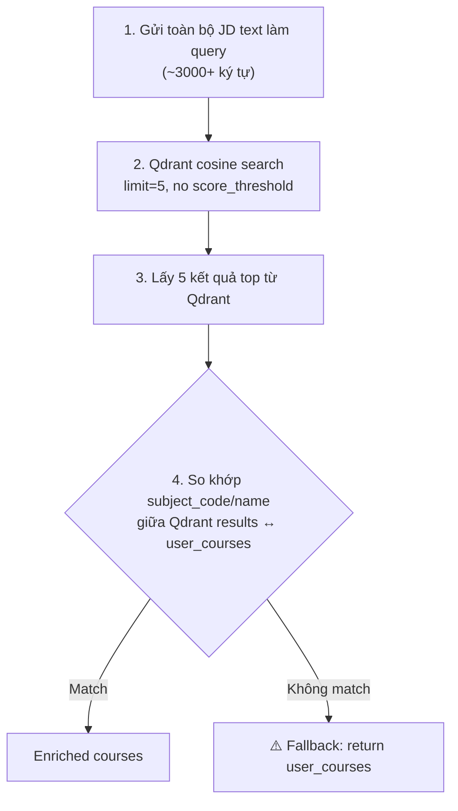

# 🔍 Phân Tích Vấn Đề: Vector Search Không Match Được Môn Học Với JD DevOps

## Tóm Tắt Vấn Đề

Khi đưa JD (Paymentology - DevOps/SRE Engineer) vào pipeline, **vector search trong Qdrant trả về kết quả** nhưng **không có kết quả nào match được với `selected_courses` của sinh viên**, dẫn đến fallback trả về toàn bộ `user_courses` gốc (không có enrichment từ vector search).

---

## Nguyên Nhân Gốc Rễ

Vấn đề nằm ở **Step 2: `node_search_courses`** trong [graph.py](file:///D:/CaoDangTayDo_Intern/generate_cv/generate-cv2026/ai-service/app/graph.py#L54-L108).

### Flow hiện tại:



### 🐛 Bug 1: Query quá dài → embedding bị "pha loãng"

Ở [graph.py dòng 65](file:///D:/CaoDangTayDo_Intern/generate_cv/generate-cv2026/ai-service/app/graph.py#L65):
```python
search_res = vector_search_service.search(query=jd_text, limit=5)
```

**Toàn bộ JD text** (~3000+ ký tự bao gồm thông tin công ty, benefits, equal opportunity statement, fraud warning...) được gửi thẳng làm query embedding. Với `text-embedding-3-small` (1536 dim), khi text quá dài:

- Embedding vector sẽ là **trung bình ngữ nghĩa** của toàn bộ nội dung → bị "pha loãng" bởi các đoạn không liên quan (company intro, equal opportunity, fraud warning...)
- Kết quả cosine similarity sẽ **thấp và không chính xác** vì embedding đại diện cho quá nhiều concepts cùng lúc

### 🐛 Bug 2: `limit=5` quá nhỏ cho matching

Chỉ lấy top 5 kết quả từ Qdrant, trong khi collection chứa cả `subject` lẫn `clo` records. Với JD DevOps dài, top 5 có thể toàn là CLO records chứ không phải subject records, hoặc là các môn không nằm trong `selected_courses` của sinh viên.

### 🐛 Bug 3: Matching logic quá strict

Ở [graph.py dòng 83-103](file:///D:/CaoDangTayDo_Intern/generate_cv/generate-cv2026/ai-service/app/graph.py#L83-L103):

```python
for item in search_res:
    payload = item.get("payload", {})
    result_keys = {
        str(value).strip().lower()
        for value in (payload.get("subject_code"), payload.get("subject_name"), payload.get("name"))
        if value
    }
    selected_course = next((course for course in user_courses if course_keys(course) & result_keys), None)
    if not selected_course:
        continue  # ← BỎ QUA nếu không exact match
```

Matching dựa trên **exact match** giữa `subject_code`/`subject_name` từ Qdrant results và `course_id`/`subjectCode`/`course_name`/`subjectName` từ user courses. Nếu naming convention khác nhau giữa Supabase và frontend → sẽ không match.

### 🐛 Bug 4: Fallback trả về `user_courses` gốc không có enrichment

```python
return {"matched_courses": matched_courses or user_courses}
```

Khi `matched_courses` rỗng → trả về `user_courses` gốc, nhưng **không có** `similarity_score`, không có CLO enrichment từ vector search. Đây là "fallback" mà bạn đang gặp.

---

## Tại Sao Trước Đây Query Được 4 Môn?

Trước đây có thể JD ngắn hơn, tập trung vào các skills cụ thể (ví dụ: "React, Node.js, SQL") → embedding vector sát nghĩa hơn với các môn trong Qdrant → top 5 results match được với `selected_courses`.

JD Paymentology hiện tại **rất dài** (~3000+ ký tự) và focus vào **DevOps/Infrastructure** (Terraform, Kubernetes, AWS, Kafka, CI/CD) — các keywords này bị chìm trong biển text không liên quan.

---

## Giải Pháp Đề Xuất

### Option A: Rút trích keywords/skills từ JD trước khi query (⭐ Recommended)

Thay vì gửi toàn bộ JD text, **rút trích các technical skills/keywords** rồi query Qdrant bằng text ngắn gọn:

```python
def node_search_courses(state: CVPipelineState) -> CVPipelineState:
    jd_text = state.get("jd_raw_text", "")
    target_job = state.get("target_job", {})
    
    # Sử dụng required_skills từ parsed JD thay vì raw text
    required_skills = target_job.get("required_skills", [])
    if required_skills:
        search_query = f"Các kỹ năng: {', '.join(required_skills)}"
    else:
        search_query = jd_text[:500]  # Chỉ lấy phần đầu nếu không có skills
    
    search_res = vector_search_service.search(query=search_query, limit=20)
    # ... rest of matching logic
```

### Option B: Multi-query strategy — query từng skill riêng

```python
all_results = []
for skill in required_skills:
    results = vector_search_service.search(query=skill, limit=3, type_filter="subject")
    all_results.extend(results)
# Deduplicate by subject_code, keep highest score
```

### Option C: Tăng limit + filter type="subject" + lower score threshold

```python
search_res = vector_search_service.search(
    query=jd_text[:1000],  # Chỉ lấy phần responsibilities
    limit=20,              # Tăng limit
    type_filter="subject"  # Chỉ lấy subjects, không lấy CLOs
)
```

---

## Các Môn Trong Qdrant Có Thể Match Với JD DevOps Này

Dựa trên CLO templates trong [sync_supabase_clos.py](file:///D:/CaoDangTayDo_Intern/generate_cv/generate-cv2026/ai-service/scripts/sync_supabase_clos.py):

| Mã Môn | Tên Môn | Lý Do Match |
|--------|---------|-------------|
| `502CNTH20` | Cloud/DevOps | Docker, CI/CD, AWS, IaC, GitHub Actions |
| `502CNTH18` | Mạng & Quản trị | Linux, SSH, Bash Script, Nginx, Network |
| `502CNLT25` | An toàn bảo mật TT | Security, firewall, giám sát mạng |
| `502CSTH09` | Công nghệ phần mềm | Agile/Scrum, Microservices |

> [!IMPORTANT]
> Với cách query hiện tại (gửi cả JD 3000+ ký tự), embedding bị pha loãng nên có thể không tìm ra đúng 4 môn này.
