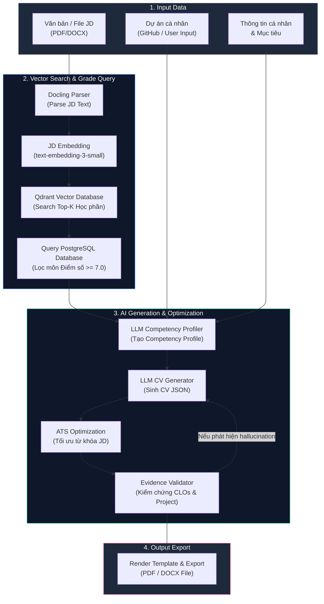

# BÁO CÁO KẾT QUẢ THỰC HIỆN MODULE GENERATE CV

**Dự án:** Hệ thống Cổng Thông Tin & Tạo CV Tự Động — Trường Cao Đẳng Tây Đô  
**Module:** Generate CV (Hệ Thống Tạo CV Thông Minh Tích Hợp AI & RAG)  
**Thành viên thực hiện:**
- Đặng Đức Toàn (Developer A)
- Lê Minh Hải (Developer B)

---

## 1. Mục tiêu của module

Module **Generate CV** được nghiên cứu và phát triển nhằm mục tiêu cho phép người dùng (đặc biệt là sinh viên) tự động tạo ra bản CV cá nhân hóa cao, chuẩn chuyên nghiệp và tối ưu hóa theo vị trí tuyển dụng thực tế.

- **Input đầu vào của module:**
  - **Job Description (JD):** Mô tả vị trí tuyển dụng từ nhà tuyển dụng (nhập văn bản trực tiếp hoặc tải file PDF, DOCX).
  - **Điểm số các học phần:** Kết quả học tập thực tế của sinh viên từ cơ sở dữ liệu PostgreSQL Supabase (chỉ lọc lấy các môn có điểm tích lũy/tổng kết $\ge 7.0$).
  - **Thông tin mô tả chuẩn đầu ra học phần (CLOs):** Các kỹ năng, kiến thức và năng lực đạt được từ từng môn học.
  - **Thông tin nhập liệu từ người dùng & Dự án cá nhân:** Các dự án cá nhân (Personal Projects), đường link GitHub repositories, mục tiêu nghề nghiệp và các kỹ năng bổ trợ do người dùng cung cấp.

- **Vấn đề giải quyết:**
  Hỗ trợ sinh viên sở hữu một bản CV chuyên nghiệp, thể hiện chính xác năng lực thực tế dựa trên minh chứng học tập và dự án (chống khai khống / loại bỏ hiện tượng hallucination của AI), tối ưu hóa từ khóa đạt chuẩn hệ thống lọc CV tự động (ATS Optimization), và tối ưu hóa tối đa thời gian ứng tuyển.

---

## 2. Kiến trúc của module & Luồng hoạt động chính

### 2.1. Mô hình kiến trúc module

Module Generate CV được xây dựng dưới dạng pipeline xử lý nối tiếp kết hợp vòng lặp kiểm chứng (LangGraph Stateful Orchestration Graph), kết nối giữa các dịch vụ: Python FastAPI AI Service, Qdrant Vector Database, PostgreSQL Supabase và Frontend React.



*Hình 1: Kiến trúc module Generate CV*

---

### 2.2. Luồng hoạt động chính

Luồng xử lý chính của module bao gồm **8 bước tuần tự**:

1. **JD Embedding:** Trích xuất văn bản từ JD (thông qua Docling đối với file PDF/DOCX), sau đó vector hóa nội dung JD thành vector 1536 chiều bằng mô hình Embedding (`text-embedding-3-small` / fastembed).
2. **Search Top-K môn học từ Vector Database:** Đưa vector JD vào Qdrant Vector Database để thực hiện so sánh Cosine Similarity với các chuẩn đầu ra (CLOs) và nội dung học phần, từ đó truy xuất ra `Top-K` học phần có nội dung khớp nhất với yêu cầu công việc.
3. **Query PostgreSQL & Lọc điểm $\ge 7.0$:** Dựa trên danh sách `Top-K` học phần lấy được từ Vector Database, thực hiện truy vấn cơ sở dữ liệu PostgreSQL để lấy kết quả học tập của sinh viên, áp dụng bộ điều kiện bổ sung: **chỉ giữ lại những môn học sinh viên đạt từ 7.0 điểm trở lên**.
4. **Tạo Hồ sơ năng lực (Competency Profile):** Tổng hợp dữ liệu từ các học phần đạt điểm cao (kèm mô tả CLOs), kết hợp với thông tin dự án cá nhân được crawl tự động từ GitHub (bằng BeautifulSoup4 / Tavily) hoặc do người dùng cung cấp. Toàn bộ thông tin này được đưa vào LLM để tổng hợp thành bản **Competency Profile** cấu trúc.
5. **Sinh CV từ Competency Profile:** Đưa Competency Profile vào LLM để biên soạn bản thảo CV hoàn chỉnh, tự động phân bổ vào các mục: Mục tiêu nghề nghiệp, Học vấn, Kỹ năng chuyên môn, Dự án nổi bật và Kinh nghiệm.
6. **Tối ưu hóa ATS (ATS Optimization):** LLM tiến hành đối chiếu bản thảo CV với JD gốc, đánh giá điểm tương thích ATS (ATS Match Score), tự động điều chỉnh từ khóa (keywords) và diễn đạt câu từ nhằm đảm bảo CV đạt tỉ lệ vượt qua các hệ thống tự động lọc CV (ATS) cao nhất.
7. **Kiểm chứng tính trung thực (Evidence Validation):** Đưa bản CV đã tối ưu ATS qua bộ kiểm chứng (Validator Service) để so sánh chéo với các minh chứng thực tế từ CLOs và thông tin dự án. Nếu phát hiện các kỹ năng (Skills) bịa ra không có bằng chứng (hallucinations), hệ thống sẽ tự động loại bỏ hoặc đề xuất chỉnh sửa.
8. **Xuất file Output (PDF/DOCX):** Render dữ liệu CV cuối cùng ra file định dạng **PDF** (sử dụng WeasyPrint và Jinja2 HTML Template) hoặc file **DOCX** (sử dụng python-docx) cho phép người dùng xem và chỉnh sửa trực tiếp.

---

## 3. Công nghệ sử dụng

Bảng tổng hợp các công nghệ chính được ứng dụng trong việc xây dựng và triển khai module Generate CV:

| Công nghệ | Mục đích sử dụng |
|:---|:---|
| **FastAPI** | Xây dựng AI Service backend hiệu năng cao, cung cấp các RESTful API endpoints bất đồng bộ (async) cho toàn bộ pipeline AI. |
| **LangGraph** | Xây dựng AI Pipeline điều phối xử lý theo luồng (stateful graph orchestration), hỗ trợ quản lý trạng thái, nhánh điều kiện và vòng lặp retry/validation. |
| **LLM (Gemini / Gemma)** | Sinh nội dung CV cá nhân hóa, gợi ý mô tả kinh nghiệm, phân tích điểm tương thích ATS và kiểm chứng minh chứng kỹ năng. |
| **Qdrant Vector Database** | Ứng dụng mô hình RAG (Retrieval-Augmented Generation) để lưu trữ vector hóa CLOs/môn học và thực hiện tìm kiếm ngữ nghĩa (Semantic Search) khớp với JD. |
| **Docling + BeautifulSoup4** | Docling trích xuất cấu trúc văn bản từ file JD (PDF, DOCX); BeautifulSoup4 / Tavily crawl thông tin mô tả dự án từ các đường link GitHub. |
| **WeasyPrint + Jinja2** | Jinja2 render dữ liệu CV vào HTML/CSS templates chuẩn A4; WeasyPrint xuất file CV định dạng PDF chất lượng cao, kết hợp `python-docx` xuất file DOCX. |

*Bảng 1: Các công nghệ được sử dụng trong module Generate CV*

---

## 4. Kết quả thực hiện

### 4.1. Chuẩn bị các môi trường cần thiết

Quá trình chuẩn bị môi trường và hạ tầng kỹ thuật cho module bao gồm:

1. **Khởi tạo cơ sở dữ liệu PostgreSQL (Supabase Cloud):**
   - Import dữ liệu chương trình đào tạo và điểm số của sinh viên (37 bảng, 577 sinh viên, 31,079 kết quả thi).
   - Thiết lập Partial Indexes và Covering Indexes (ví dụ: `idx_exam_results_student_subject_score`) trên PostgreSQL giúp truy vấn cực nhanh các môn học đạt điểm $\ge 7.0$.

2. **Khởi tạo Python AI Service (FastAPI):**
   - Cấu hình dự án Python 3.11 tại thư mục `/ai-service`.
   - Cài đặt hệ sinh thái thư viện AI: `fastapi`, `langgraph`, `qdrant-client`, `docling`, `weasyprint`, `jinja2`, `python-docx`, `beautifulsoup4`, `openai`, `google-generativeai`.

3. **Cấu hình Qdrant Vector Database:**
   - Đóng gói container Qdrant Vector Database chạy độc lập trên Port 6333.
   - Vector hóa toàn bộ chuẩn đầu ra CLOs và mô tả môn học bằng mô hình `text-embedding-3-small` (1536 chiều) và nạp vào Qdrant Collection `subject_clos`.

4. **Khởi tạo Backend Gateway (.NET 8) & Frontend (React + Vite):**
   - Backend .NET 8 Web API đảm nhận vai trò Gateway xác thực JWT và cung cấp dữ liệu nền tảng.
   - Frontend React + Vite + TypeScript xây dựng giao diện tương tác chuyên biệt cho CV Builder.

5. **Đóng gói Docker Compose toàn hệ thống:**
   - Cấu hình file `docker-compose.yml` chạy đồng thời 4 dịch vụ (`taydo_frontend`, `taydo_backend`, `taydo_ai_service`, `qdrant_db`) kết nối thống nhất trong cùng một mạng `taydo_network`.

**Cấu trúc thư mục dự án liên quan đến module:**

```
generate-cv2026/
├── ai-service/               # Python FastAPI AI Service & LangGraph Pipeline
│   ├── app/
│   │   ├── routers/          # API Endpoints (cv.py, parse_jd.py, search.py, export.py...)
│   │   ├── services/         # Logic nghiệp vụ AI (RAG, LLM, Scraper, Validator...)
│   │   ├── templates/        # Templates HTML/CSS chuẩn CV A4
│   │   ├── graph.py          # Khởi tạo LangGraph Stateful Pipeline
│   │   └── main.py           # FastAPI Application Entrypoint
│   ├── Dockerfile
│   └── requirements.txt
│
├── backend/                  # Mã nguồn Backend .NET 8 Web API Gateway
│   ├── Controllers/          # API Controllers kết nối cơ sở dữ liệu Supabase
│   └── Dockerfile
│
├── frontend/                 # Giao diện Frontend React + Vite + TypeScript
│   ├── src/
│   │   ├── pages/student/    # Giao diện CV Builder (/student/cv)
│   │   └── components/       # Components UI (Split-pane, Real-time Preview)
│   └── Dockerfile
│
├── docs/                     # Tài liệu thiết kế & Báo cáo module
└── docker-compose.yml        # Docker Compose quản lý 4 container
```

---

### 4.2. Hệ thống phân quyền

Hệ thống phân quyền cho module Generate CV được kiểm soát dựa trên trường `Role` với token xác thực **JWT Bearer Token** giữa các dịch vụ:

| Mã Role | Vai trò | Quyền hạn trong module Generate CV |
|:-------:|---------|-----------------------------------|
| **1** | **Sinh viên** (`sv_toan`) | **Quyền khởi tạo & quản lý CV cá nhân:** Nhập/tải JD, dán link GitHub, chạy pipeline AI tạo CV, xem điểm ATS, kiểm tra minh chứng và tải về file PDF/DOCX. |
| **10** | **Giảng viên** (`giaovien1`) | **Quyền xem & đánh giá:** Xem bảng điểm, CLOs môn học và danh sách CV mẫu do sinh viên thuộc lớp quản lý khởi tạo. |
| **20 / 50** | **TBM / Trưởng Khoa** | **Quyền quản trị danh mục:** Xem thống kê số lượng CV được tạo theo khoa/ngành, quản lý dữ liệu chuẩn đầu ra CLOs. |
| **99** | **Admin** (`admin1`) | **Quyền cấu hình hệ thống:** Cấu hình Prompt LLM, quản lý API Keys, quản lý Qdrant Collection và xem nhật ký gọi AI API (Audit Logs). |

*Bảng 2: Hệ thống phân quyền theo vai trò trong module Generate CV*

---

### 4.3. Xây dựng các API

Module được tích hợp bộ RESTful API phong phú gồm **8 API Endpoints tại Python AI Service** và các API Gateway tại Backend .NET 8:

#### 4.3.1. Danh sách API Endpoints tại AI Service (`/api/v1`)

| STT | API Endpoint | Method | Chức năng | Tham số Input | Kết quả Output |
|:---:|--------------|:------:|-----------|---------------|----------------|
| 1 | `/api/v1/cv/generate` | POST | Khởi chạy toàn bộ LangGraph Pipeline 8 bước tạo CV | `student_id`, `jd_text`, `github_url` | Full `CV_Data` JSON, ATS score, Validation |
| 2 | `/api/v1/jd/parse` | POST | Trích xuất văn bản từ file JD (PDF/DOCX) bằng Docling | `file` (Multipart) | `jd_text`, extracted keywords |
| 3 | `/api/v1/search/subjects` | POST | Vector Search Qdrant tìm Top-K học phần khớp JD | `jd_text`, `top_k` | Danh sách `subject_id`, similarity score |
| 4 | `/api/v1/competency/build` | POST | Query điểm $\ge 7.0$ & crawl GitHub sinh Competency Profile | `student_id`, `subject_ids` | `competency_profile.json` |
| 5 | `/api/v1/ats/optimize` | POST | Phân tích điểm ATS Match & bổ sung từ khóa tối ưu | `cv_json`, `jd_text` | `optimized_cv.json`, ATS Score (%) |
| 6 | `/api/v1/cv/validate` | POST | Kiểm chứng minh chứng (CLOs/Project) phát hiện hallucination | `optimized_cv.json`, `evidence` | `validated_cv.json`, Trust Score (%) |
| 7 | `/api/v1/export/pdf` | POST | Render HTML template & xuất file PDF qua WeasyPrint | `cv_json`, `template_id` | File binary `CV_Output.pdf` |
| 8 | `/api/v1/export/docx` | POST | Xuất file CV định dạng DOCX qua `python-docx` | `cv_json` | File binary `CV_Output.docx` |

*Bảng 3: Các API Endpoints của AI Service cho module Generate CV*

#### 4.3.2. Tích hợp Backend API Gateway (.NET 8)

- `GET /api/reports/cv-data/{studentId}`: Cung cấp toàn bộ dữ liệu nền tảng của sinh viên (hồ sơ cá nhân, danh sách điểm thành phần) cho AI Service truy vấn.

---

### 4.4. Quy trình thực hiện và Giao diện người dùng

Quá trình người dùng (Sinh viên) tương tác với module Generate CV được thực hiện theo quy trình từng bước trực quan, tự động hóa cao dựa trên luồng trải nghiệm người dùng (User Journey):

---

#### **Bước 1: Đăng nhập hệ thống và Truy cập công cụ CV Builder**

- **Thao tác người dùng:**
  - Sinh viên truy cập vào ứng dụng tại giao diện đăng nhập `/login`.
  - Nhập tên đăng nhập (ví dụ: `sv_toan`) và mật khẩu, hoặc sử dụng tính năng **Chọn nhanh tài khoản demo Sinh viên** để điền tự động thông tin.
  - Sau khi đăng nhập thành công, sinh viên tại thanh menu điều hướng bên trái (Sidebar) chọn mục **"Tạo CV"** hoặc nhấn nút **"Tạo CV bằng AI"** ngay trên trang Dashboard Sinh viên (`/student`).

- **API xử lý phía sau:**
  - `POST /api/auth/login`: Xác thực thông tin tài khoản sinh viên, trả về **JWT Bearer Token** chứa `Role: 1`.
  - `GET /api/student/dashboard`: Lấy thông tin sơ yếu lý lịch cá nhân và điểm tích lũy GPA của sinh viên từ database.

- **Hiển thị trên giao diện người dùng:**
  - Hệ thống tự động chuyển hướng đến giao diện **CV Builder (`/student/cv`)** áp dụng phong cách thiết kế Dark Theme với bố cục chia đôi màn hình (Split-pane layout): cột bên trái là khung nhập liệu cấu hình, cột bên phải là khung xem trước CV thời gian thực.
  - `[Hình 2: Giao diện Đăng nhập hệ thống và tính năng chọn nhanh tài khoản demo Sinh viên]`
  - `[Hình 3: Giao diện tổng quan công cụ CV Builder với bố cục chia đôi màn hình Split-pane]`

---

#### **Bước 2: Cung cấp thông tin tuyển dụng (JD) và Đường dẫn Dự án (GitHub)**

- **Thao tác người dùng:**
  - Sinh viên chọn cách thức cung cấp thông tin bài tuyển dụng (Job Description - JD):
    - **Cách 1:** Dán trực tiếp văn bản yêu cầu tuyển dụng từ trang tìm việc vào khung văn bản.
    - **Cách 2:** Nhấn nút **"Tải file JD"** để kéo thả tập tin đính kèm (định dạng `.pdf` hoặc `.docx`).
  - Sinh viên dán đường link kho chứa mã nguồn dự án cá nhân trên GitHub (ví dụ: `https://github.com/username/project-name`) vào ô nhập **"GitHub Repository Link"**.
  - Nhập bổ sung Mục tiêu nghề nghiệp cá nhân, chọn các kỹ năng mềm/ngôn ngữ mong muốn thể hiện thêm trên CV.

- **API xử lý phía sau:**
  - `POST /api/v1/jd/parse` (Python AI Service): Trích xuất toàn bộ văn bản từ tập tin PDF/DOCX bằng thư viện Docling và bóc tách các từ khóa kỹ thuật chuyên ngành.
  - `POST /api/v1/scrape/github` (Python AI Service): Crawl tự động thông tin tập tin `README.md`, mô tả dự án và danh sách ngôn ngữ/công nghệ từ đường link GitHub do sinh viên cung cấp qua BeautifulSoup4 / Tavily API.

- **Hiển thị trên giao diện người dùng:**
  - Văn bản JD đã trích xuất được hiển thị trong khung **"Xem trước văn bản JD"** kèm theo danh sách từ khóa chuyên ngành được đánh dấu nổi bật.
  - Thẻ dự án cá nhân tự động cập nhật các thông số: Tên dự án, Mô tả ngắn, Công nghệ sử dụng và chỉ số Stars/Forks.
  - `[Hình 4: Thao tác tải file JD PDF/Word và tự động bóc tách nội dung văn bản bằng Docling]`
  - `[Hình 5: Khung nhập link GitHub và kết quả tự động crawl thông tin dự án cá nhân]`

---

#### **Bước 3: Khởi chạy Pipeline AI Tạo CV tự động**

- **Thao tác người dùng:**
  - Sinh viên kiểm tra thông tin đã nhập và nhấn nút bấm nổi bật **"Khởi Tạo CV Bằng AI"** (nút bấm thiết kế nổi bật với hiệu ứng Gradient xanh lá và biểu tượng Sparkles AI).

- **API xử lý phía sau:**
  - `POST /api/v1/cv/generate`: Khởi chạy toàn bộ LangGraph Pipeline 8 bước tại Python AI Service. Trực tiếp kích hoạt chuỗi API nối tiếp:
    1. `POST /api/v1/search/subjects`: Qdrant Vector Search tìm `Top-K` học phần có chuẩn đầu ra (CLOs) khớp với JD.
    2. `GET /api/reports/cv-data/{studentId}` (Backend .NET 8 API Gateway): Query kết quả học tập trong PostgreSQL và áp dụng bộ lọc chỉ giữ lại những môn học sinh viên đạt điểm $\ge 7.0$.
    3. `POST /api/v1/competency/build`: LLM tổng hợp các môn học điểm cao + CLOs + dữ liệu dự án thành bản `competency_profile.json`.
    4. `POST /api/v1/cv/generator`: LLM biên soạn dữ liệu CV hoàn chỉnh dưới dạng JSON cấu trúc.

- **Hiển thị trên giao diện người dùng:**
  - Hệ thống hiển thị thanh tiến trình xử lý (Progress Indicator) kèm các thông báo trạng thái cập nhật theo thời gian thực: *"Đang phân tích vector JD..."*, *"Đang lọc học phần đạt điểm $\ge 7.0$..."*, *"Đang sinh Hồ sơ năng lực..."*, *"Đang biên soạn CV..."*.
  - Khung xem trước CV ở cột bên phải tự động nạp dữ liệu và render thành bản CV trang A4 chuyên nghiệp theo font chữ Inter chuẩn quốc tế.
  - `[Hình 6: Màn hình hiển thị tiến trình xử lý thời gian thực của AI Service LangGraph Pipeline]`
  - `[Hình 7: Bản xem trước CV thời gian thực (Real-time Live Preview) theo chuẩn định dạng trang A4]`

---

#### **Bước 4: Xem Phân tích ATS Match Score và Kiểm chứng Minh chứng (Evidence Validation)**

- **Thao tác người dùng:**
  - Sinh viên chuyển sang tab **"Phân Tích ATS & Minh Chứng"** ngay trên giao diện xem trước để đánh giá chất lượng CV.
  - Sinh viên xem điểm đánh giá từ AI, kiểm tra các kỹ năng được gắn nhãn minh chứng và đọc gợi ý tối ưu từ khóa.

- **API xử lý phía sau:**
  - `POST /api/v1/ats/optimize`: Phân tích đối chiếu nội dung CV với JD gốc, tính toán **ATS Match Score (%)**, bóc tách danh sách từ khóa đã đạt (Matched Keywords) và từ khóa cần bổ sung (Missing Keywords).
  - `POST /api/v1/cv/validate`: Kiểm chứng đối chiếu từng kỹ năng (Skill) trong CV với bằng chứng thực tế từ CLOs học phần và dự án GitHub. Đánh giá **Chỉ số tin cậy minh chứng (Trust Score %)** và lọc bỏ kỹ năng bịa ra (hallucination).

- **Hiển thị trên giao diện người dùng:**
  - Biểu đồ Donut đồ họa hiển thị chỉ số **ATS Match Score** (ví dụ: `85% Match`) và **Trust Score** (ví dụ: `95% Verified`).
  - Danh sách Kỹ năng (Skills) được gắn các Badge màu xanh **"Verified by CLO"** (xác thực từ bài thi/môn học) hoặc badge **"Verified by GitHub"** (xác thực từ mã nguồn dự án). Các kỹ năng nghi ngờ thiếu minh chứng sẽ hiển thị viền đỏ cảnh báo kèm gợi ý chỉnh sửa.
  - `[Hình 8: Bảng phân tích điểm tương thích ATS (ATS Match Score) và danh sách từ khóa chuyên ngành]`
  - `[Hình 9: Khung kiểm chứng minh chứng kỹ năng (Evidence Validation) với nhãn dán Verified by CLO]`

---

#### **Bước 5: Tùy chỉnh trực tiếp và Xuất file CV (Export PDF/DOCX)**

- **Thao tác người dùng:**
  - Sinh viên có thể bấm trực tiếp vào các khối văn bản trên bản xem trước để chỉnh sửa nhanh thông tin cá nhân, mục tiêu hoặc mô tả dự án theo ý thích.
  - Sau khi hài lòng với bản CV, sinh viên chọn định dạng xuất file:
    - **Nút "Xuất File PDF":** Để tải bản CV định dạng PDF chất lượng cao phục vụ nộp ứng tuyển ngay.
    - **Nút "Xuất File DOCX":** Để tải bản Word phục vụ tiếp tục tinh chỉnh định dạng thủ công trên Microsoft Word.

- **API xử lý phía sau:**
  - `POST /api/v1/export/pdf`: Render dữ liệu CV thông qua Jinja2 HTML/CSS Template chuẩn A4 và xuất file nhị phân PDF chất lượng cao bằng WeasyPrint.
  - `POST /api/v1/export/docx`: Xuất file nhị phân Word (`.docx`) bằng thư viện `python-docx`.

- **Hiển thị trên giao diện người dùng:**
  - Trình duyệt tự động kích hoạt tải xuống tập tin `CV_[Tên_Sinh_Viên]_[Ngành_Học].pdf` hoặc `CV_[Tên_Sinh_Viên]_[Ngành_Học].docx`.
  - Hệ thống hiển thị thông báo Toast Notification xanh: *"Xuất file CV thành công! Chúc bạn ứng tuyển thành công."*
  - `[Hình 10: Thao tác chỉnh sửa trực tiếp thông tin CV trên giao diện Live Preview]`
  - `[Hình 11: Màn hình kết quả xuất file CV định dạng PDF chuyên nghiệp và file DOCX cho sinh viên]`


---

## 4.6. Vòng xác thực thực tập Mẫu 07 (Kinh nghiệm thực tập đã xác thực)

Mục **"6. Kinh nghiệm thực tập & làm việc"** không chỉ là dữ liệu khai báo mà còn hỗ trợ một **vòng xác thực đầy đủ** để mỗi dòng kinh nghiệm có thể đạt trạng thái **"Đã xác thực"** và hiển thị badge xác minh trên CV.

### 4.6.1. Quy trình 4 bước

```
[Sinh viên nhập Mục 6]           [AI Service tạo Mẫu 07]
        │                                 │
        ▼                                 ▼
   Nhập thêm: Địa chỉ DN, Chuyên gia hướng dẫn ──► POST /api/export/mau07
                                                       (template-fill docx 100% đúng mẫu)
        │
        ▼
[Chuyên gia DN ký & đóng mộc trên giấy]
        │
        ▼
[Sinh viên chụp/quét → nộp file đã ký lên hệ thống]
        │  POST /api/internship-verifications (multipart, lưu bytea)
        ▼
[GV / Trưởng BM / Trưởng khoa (roles 10/20/50) duyệt]
        │  GET /pending → GET /{id}/file → POST /{id}/approve | /reject
        ▼
[CV hiển thị badge "✓ Đã xác thực" + tên người duyệt]
```

### 4.6.2. Nguyên tắc "một dữ liệu – hai đầu ra" (One Data – Two Outputs)

- Dữ liệu **Kinh nghiệm thực tập** người dùng nhập ở Mục 6 là nguồn dữ liệu duy nhất.
- **Đầu ra 1 – CV**: Phần "Kinh nghiệm thực tập & làm việc" trong CV PDF/DOCX dùng trực tiếp dữ liệu này.
- **Đầu ra 2 – Phiếu Mẫu 07**: `POST /api/export/mau07` dùng **chính** dữ liệu Mục 6 (cộng thêm 2 trường mới *Địa chỉ doanh nghiệp* và *Chuyên gia hướng dẫn*) để điền vào **template DOCX gốc** của Trường, giữ nguyên 100% bố cục, watermark và các khối chữ ký — **không render lại từ đầu** nhằm đảm bảo tính pháp lý.

### 4.6.3. Vì sao xác thực bởi 3 vai trò (10/20/50)?

- **Giáo viên (10)**: Là người hướng dẫn, nắm rõ nội dung thực tập của sinh viên.
- **Trưởng Bộ Môn (20)**: Kiểm soát tính hợp lệ của phiếu đánh giá theo quy chế khoa.
- **Trưởng Khoa (50)**: Người chịu trách nhiệm cuối cùng, xác nhận chính thức.
- Bất kỳ ai trong 3 vai trò duyệt đều ghi nhận `ApproverId`, `ApprovalName` và `ApprovalDate` vào hồ sơ, tạo chuỗi trách nhiệm rõ ràng.

### 4.6.4. Lưu trữ & hiển thị

- File DOCX đã ký được lưu dưới dạng **`bytea`** trong bảng `InternshipVerifications` (PostgreSQL Supabase) kèm `FileName`, `ContentType`, `Status` (0=Đã nộp, 1=Đã xác thực, 2=Từ chối), `Note`, `SubmissionDate`, `ApprovalDate`.
- Sinh viên có thể **tải lại phiếu đã duyệt**; giảng viên **tải phiếu** để đối chiếu trước khi duyệt.
- CV preview (live) và CV PDF/DOCX hiển thị chip **"✓ Đã xác thực"** màu xanh cạnh tên công ty khi `verificationStatus === 1`.


---

## 5. Kết luận

### 5.1. Kết quả đạt được

- ✅ Xây dựng thành công **Python AI Service (FastAPI)** kết hợp **LangGraph Orchestration** điều phối pipeline 8 bước tạo CV tự động.
- ✅ Tích hợp thành công **Qdrant Vector Database** thực hiện RAG tìm kiếm ngữ nghĩa giữa nội dung JD và chuẩn đầu ra CLOs của các học phần.
- ✅ Áp dụng thành công cơ chế **Query lọc điểm số $\ge 7.0$** từ PostgreSQL Supabase để đảm bảo CV phản ánh đúng năng lực học tập thực tế.
- ✅ Phát triển tính năng **ATS Optimization** giúp tối ưu hóa từ khóa và tăng tỉ lệ duyệt CV tự động.
- ✅ Xây dựng bộ **Evidence Validator** kiểm chứng tính trung thực của CV, phát hiện và loại bỏ các kỹ năng bịa ra (anti-hallucination).
- ✅ Cung cấp đa dạng định dạng đầu ra **PDF** (WeasyPrint) và **DOCX** (python-docx) cùng giao diện xem trước thời gian thực (Real-time Preview) trên React Frontend.

### 5.2. Hạn chế và hướng phát triển

- ⏳ **Tốc độ sinh dữ liệu LLM:** Pipeline AI 8 bước cần khoảng 5-10 giây để hoàn thành đầy đủ. Cần tối ưu hóa streaming response (Server-Sent Events) để phản hồi người dùng mượt mà hơn.
- ⏳ **Crawl dự án nâng cao:** Cần mở rộng bộ scraper để hỗ trợ thêm các nền tảng lưu trữ dự án khác như GitLab, Bitbucket, Behance.
- ⏳ **Đa dạng hóa Template CV:** Bổ sung thêm nhiều phong cách template CV (Minimalist, Corporate, Modern, Creative) cho người dùng lựa chọn.
