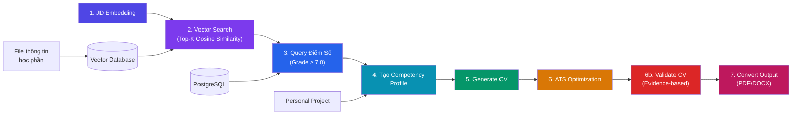
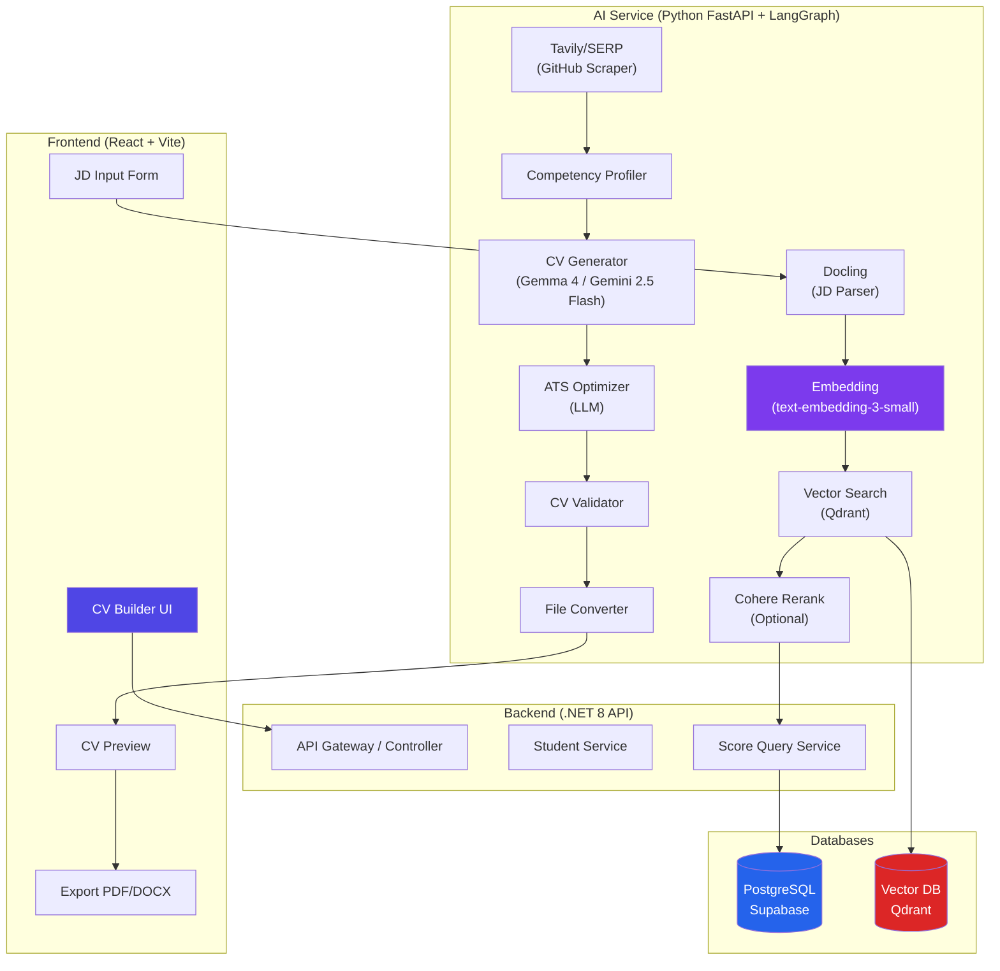
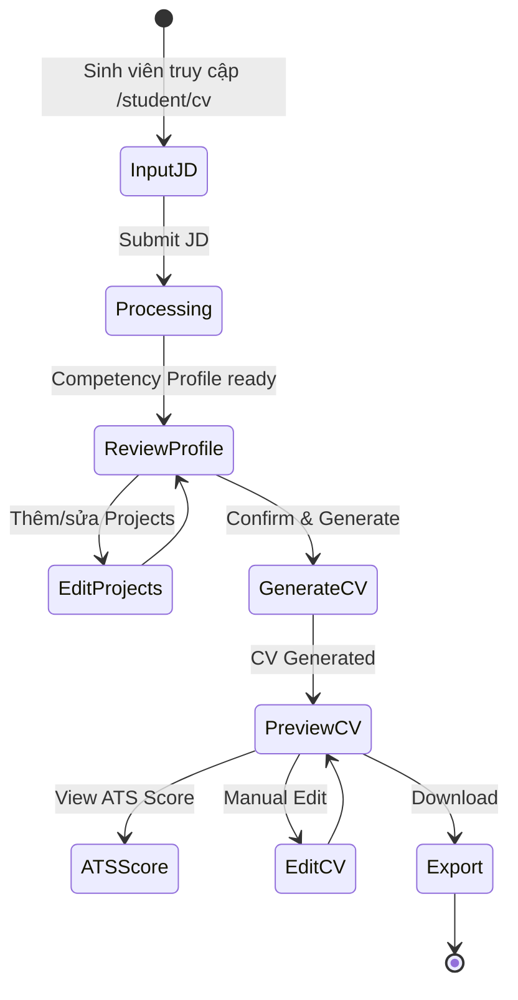

# 📄 Plan Triển Khai: Generate CV – Hệ Thống Tạo CV Thông Minh

> **Dự án**: generateCV – Trường Cao Đẳng Tây Đô  
> **Ngày tạo**: 2026-07-21 | **Cập nhật**: 2026-07-21  
> **Kiến trúc tham chiếu**: [image.png](file:///D:/CaoDangTayDo_Intern/generate_cv/generate-cv2026/image.png)

### 📎 Tài Liệu Liên Quan
- [competency_profile_plan.md](file:///D:/CaoDangTayDo_Intern/generate_cv/generate-cv2026/docs/competency_profile_plan.md) – Plan chi tiết xây dựng Competency Profile
- [database_index_plan.md](file:///D:/CaoDangTayDo_Intern/generate_cv/generate-cv2026/docs/database_index_plan.md) – Plan đặt index database cho query điểm số
- [note_tech.md](file:///D:/CaoDangTayDo_Intern/generate_cv/generate-cv2026/docs/note_tech.md) – Ghi chú công nghệ đã chọn

---

## 🗺️ Tổng Quan Kiến Trúc (Architecture Overview)

Dựa trên sơ đồ kiến trúc, pipeline Generate CV gồm **7 bước tuần tự**:



### Luồng Dữ Liệu Chi Tiết

| Bước | Tên | Input | Output | Database |
|:---:|:---|:---|:---|:---:|
| 1 | **JD Embedding** | Job Description (text) | Search Vector | – |
| 2 | **Vector Search** | Search Vector | Top-K học phần (id, CLOs,...) | Vector DB |
| 3 | **Query Điểm Số** | Top-K học phần IDs | Điểm học phần + CLOs (≥ 7.0) | PostgreSQL |
| 4 | **Tạo Competency Profile** | Điểm + CLOs + Personal Projects | `competency_profile.json` | – |
| 5 | **Generate CV** | `competency_profile.json` | `cv.json` | – |
| 6 | **ATS Optimization** | `cv.json` | `ATS_cv.json` | – |
| 6b | **Validate CV** | `ATS_cv.json` + CLOs/Projects | `validated_cv.json` | – |
| 7 | **Convert Output** | `validated_cv.json` | PDF / DOCX cho người dùng | – |

---

## 📦 Phân Tích Hiện Trạng (Current State)

### ✅ Đã có sẵn
- **Backend .NET 8 Web API** với Entity Framework Core + Supabase PostgreSQL
- **Frontend React + Vite + TypeScript** với dashboard đầy đủ
- **Entities**: `Student`, `Subject`, `ExamResult`, `SubjectTeaching`, `SubjectTeachingExam`, `Major`, `Faculty`,...
- **CV Builder page** cơ bản tại `/student/cv` ([CVBuilder.tsx](file:///D:/CaoDangTayDo_Intern/generate_cv/generate-cv2026/frontend/src/pages/student/CVBuilder.tsx))
- **Docker Compose** đã cấu hình backend + frontend
- File mẫu [competency_profile_exam.json](file:///D:/CaoDangTayDo_Intern/generate_cv/generate-cv2026/competency_profile_exam.json) – cấu trúc dữ liệu tham chiếu

### 🔴 Cần xây dựng mới
- Python AI Service với **LangGraph** orchestration (Embedding + Vector Search + LLM)
- **Qdrant** Vector Database (đã xác nhận)
- Pipeline 7 bước hoàn chỉnh dạng **LangGraph stateful graph**
- **Docling** để parse JD từ file (PDF/DOCX)
- **Tavily / SERP API** để scrape thông tin project từ GitHub
- API endpoints mới cho CV Generation
- Frontend workflow mới cho AI-powered CV
- **Database indexes** tối ưu query điểm số (xem [database_index_plan.md](file:///D:/CaoDangTayDo_Intern/generate_cv/generate-cv2026/docs/database_index_plan.md))

---

## 🏗️ Kiến Trúc Kỹ Thuật Đề Xuất

### Tổng Quan Service Architecture



### Tech Stack Đã Xác Nhận ✅

| Layer | Công nghệ | Lý do chọn | Status |
|:---|:---|:---|:---:|
| **Pipeline Orchestration** | **LangGraph** | Stateful graph, conditional edges, streaming progress, retry built-in | ✅ Confirmed |
| **AI Service** | Python 3.11 + **FastAPI** | Hệ sinh thái ML/AI tốt nhất, async support | ✅ Confirmed |
| **JD Parser** | **Docling** | Parse JD từ PDF/DOCX thành structured text trước khi embedding | ✅ Confirmed |
| **Embedding Model** | **OpenAI `text-embedding-3-small`** | 1536-dim, chất lượng cao, giá rẻ ($0.02/1M tokens) | ✅ Confirmed |
| **Vector Database** | **Qdrant** (Docker) | Open-source, dễ triển khai, filtering + payload tốt | ✅ Confirmed |
| **Reranking** | **Cohere Rerank** (Optional) | Cross-encoder cải thiện precision, free tier 1000 calls/tháng | 🟡 Optional |
| **LLM** | **Google Gemma 4 (27B)** / **Gemini 2.5 Flash** | Gemma 4 self-hosted cho privacy, Gemini Flash cho speed | ✅ Confirmed |
| **GitHub Scraper** | **Tavily** / **SERP API** | Tự động scrape thông tin project từ GitHub link | ✅ Confirmed |
| **Database Indexing** | **PostgreSQL Partial + Covering Indexes** | 8 indexes tối ưu query điểm số (xem plan riêng) | ✅ Planned |
| **PDF Export** | WeasyPrint (Python) hoặc Puppeteer (Node) | HTML → PDF chất lượng cao | Pending |
| **DOCX Export** | python-docx | Tạo file Word chuẩn | Pending |

### LangGraph Pipeline Architecture

```mermaid
graph LR
    START((Start)) --> N1["jd_parsing\n(Docling)"]
    N1 --> N2["jd_embedding\n(text-embedding-3-small)"]
    N2 --> N3["vector_search\n(Qdrant)"]
    N3 --> N3b{"Cohere\nRerank?"}
    N3b -->|Yes| N3c["rerank\n(Cohere)"]
    N3b -->|No| N4
    N3c --> N4["query_scores\n(Supabase + Indexes)"]
    N4 --> N4b["scrape_projects\n(Tavily/SERP)"]
    N4b --> N5["build_competency"]
    N5 --> N6["generate_cv\n(Gemma 4 / Gemini Flash)"]
    N6 --> N7["ats_optimize"]
    N7 --> C{ATS Score\n>= 70?}
    C -->|Yes| N8["validate_cv"]
    C -->|No| N6
    N8 --> C2{Trust Score\n>= 80?}
    C2 -->|Yes| N9["export_output"]
    C2 -->|No| N6
    N9 --> END((End))

    style N1 fill:#4f46e5,color:#fff
    style N2 fill:#7c3aed,color:#fff
    style N3 fill:#7c3aed,color:#fff
    style N3c fill:#a855f7,color:#fff
    style N4 fill:#2563eb,color:#fff
    style N4b fill:#0891b2,color:#fff
    style N5 fill:#0891b2,color:#fff
    style N6 fill:#059669,color:#fff
    style N7 fill:#d97706,color:#fff
    style N8 fill:#dc2626,color:#fff
    style N9 fill:#be185d,color:#fff
```



---

## 📋 Plan Triển Khai Chi Tiết – 7 Phase

---

### Phase 0: Chuẩn Bị Hạ Tầng & Dữ Liệu
> **Thời gian ước tính**: 2-3 ngày

#### 0.1 – Tạo AI Service (Python FastAPI)
```
generate-cv2026/
├── ai-service/                    # ← MỚI
│   ├── app/
│   │   ├── __init__.py
│   │   ├── main.py               # FastAPI app entry point
│   │   ├── config.py             # Environment variables & settings
│   │   ├── routers/
│   │   │   ├── __init__.py
│   │   │   ├── embedding.py      # /api/embed
│   │   │   ├── search.py         # /api/search
│   │   │   ├── cv.py             # /api/generate-cv
│   │   │   └── export.py         # /api/export
│   │   ├── services/
│   │   │   ├── __init__.py
│   │   │   ├── embedding_service.py
│   │   │   ├── vector_search_service.py
│   │   │   ├── competency_service.py
│   │   │   ├── cv_generator_service.py
│   │   │   ├── ats_optimizer_service.py
│   │   │   ├── validator_service.py
│   │   │   └── export_service.py
│   │   ├── models/
│   │   │   ├── __init__.py
│   │   │   ├── schemas.py        # Pydantic models
│   │   │   └── prompts.py        # LLM prompt templates
│   │   └── utils/
│   │       ├── __init__.py
│   │       └── db.py             # PostgreSQL connection helper
│   ├── data/
│   │   └── course_data/          # File thông tin học phần (để index)
│   ├── Dockerfile
│   ├── requirements.txt
│   └── .env.example
```

#### 0.2 – Thiết lập Vector Database (Qdrant)
- Thêm Qdrant vào `docker-compose.yml`
- Tạo collection `course_embeddings` với dimension phù hợp

#### 0.3 – Chuẩn bị dữ liệu học phần
- Thu thập thông tin học phần: mã HP, tên, mô tả, CLOs (Course Learning Outcomes)
- Format thành file JSON/CSV chuẩn
- Viết script `seed_vectors.py` để index vào Qdrant

#### 0.4 – Cập nhật Docker Compose
```yaml
# Thêm vào docker-compose.yml
services:
  # ... existing backend & frontend ...
  
  ai-service:
    build: ./ai-service
    container_name: taydo_ai_service
    ports:
      - "8000:8000"
    environment:
      - DATABASE_URL=${DATABASE_URL}
      - QDRANT_URL=http://qdrant:6333
      - LLM_API_KEY=${LLM_API_KEY}
      - EMBEDDING_MODEL=${EMBEDDING_MODEL}
    depends_on:
      - qdrant
    networks:
      - taydo_network

  qdrant:
    image: qdrant/qdrant:latest
    container_name: taydo_qdrant
    ports:
      - "6333:6333"
    volumes:
      - qdrant_data:/qdrant/storage
    networks:
      - taydo_network

volumes:
  qdrant_data:
```

> [!IMPORTANT]
> **Đã xác nhận**: Embedding = `text-embedding-3-small` (OpenAI), LLM = `Gemma 4 (27B)` hoặc `Gemini 2.5 Flash`, JD Parser = `Docling`, Vector DB = `Qdrant`.

---

### Phase 1: JD Parsing + Embedding (Bước 1)
> **Thời gian ước tính**: 2-3 ngày

#### Mô tả
Sinh viên nhập hoặc upload **Job Description (JD)** → **Docling** parse file (PDF/DOCX/text) thành structured text → **text-embedding-3-small** chuyển thành vector embedding.

#### Triển khai

**Bước 1a – JD Parsing với Docling**:
```python
from docling.document_converter import DocumentConverter

class JDParserService:
    def __init__(self):
        self.converter = DocumentConverter()
    
    def parse_file(self, file_path: str) -> str:
        """Parse JD từ PDF/DOCX thành plain text"""
        result = self.converter.convert(file_path)
        return result.document.export_to_markdown()
    
    def parse_text(self, raw_text: str) -> dict:
        """Extract structured info từ JD text (job title, skills, etc.)"""
        # Dùng LLM để extract structured data từ raw JD
        return self._extract_with_llm(raw_text)
```

**Bước 1b – Embedding với text-embedding-3-small**:
```python
from openai import OpenAI

class EmbeddingService:
    def __init__(self):
        self.client = OpenAI(api_key=settings.OPENAI_API_KEY)
        self.model = "text-embedding-3-small"  # 1536-dim
    
    def embed_text(self, text: str) -> list[float]:
        """Chuyển JD text thành vector embedding"""
        response = self.client.embeddings.create(
            input=text,
            model=self.model
        )
        return response.data[0].embedding
    
    def embed_jd(self, job_title: str, required_skills: list[str], 
                 description: str) -> list[float]:
        """Kết hợp các thành phần JD thành 1 embedding tối ưu"""
        combined = f"Job: {job_title}. Skills: {', '.join(required_skills)}. {description}"
        return self.embed_text(combined)
```

**API Endpoint** – `POST /api/embed`:
```json
// Request
{
  "job_title": "Backend Developer",
  "required_skills": ["ASP.NET Core", "REST API", "Docker", "PostgreSQL"],
  "description": "Develop and maintain RESTful APIs..."
}

// Response
{
  "embedding": [0.023, -0.145, ...],  // 384-dim vector
  "model": "all-MiniLM-L6-v2"
}
```

#### Tasks
- [ ] Cài đặt `docling` và test parse PDF/DOCX JD files
- [ ] Cài đặt `openai` SDK, cấu hình API key
- [ ] Implement `JDParserService` (Docling) + `EmbeddingService` (text-embedding-3-small)
- [ ] Tạo API endpoint `/api/parse-jd` + `/api/embed`
- [ ] Viết unit test cho parsing quality và embedding consistency
- [ ] Benchmark thời gian: parsing (< 2s) + embedding (< 500ms)
- [ ] Cập nhật Qdrant collection dimension = **1536** (khớp với text-embedding-3-small)

---

### Phase 2: Vector Search (Bước 2)
> **Thời gian ước tính**: 2-3 ngày

#### Mô tả
Tìm kiếm trong Vector Database để lấy **Top-K học phần** có cosine similarity cao nhất với JD embedding.

#### Triển khai

**Chuẩn bị dữ liệu** – `seed_vectors.py`:
```python
# Mỗi học phần được embed bao gồm:
course_text = f"""
Môn: {course.name}
Mã: {course.code}
Mô tả: {course.description}
CLOs: {', '.join(course.clos)}
Kỹ năng: {', '.join(course.skills)}
"""
```

**AI Service** – `vector_search_service.py`:
```python
from qdrant_client import QdrantClient

class VectorSearchService:
    def __init__(self):
        self.client = QdrantClient(url=settings.QDRANT_URL)
    
    async def search_courses(self, query_vector: list[float], 
                             top_k: int = 10) -> list[CourseMatch]:
        """Tìm top-K học phần tương đồng nhất với JD"""
        results = self.client.search(
            collection_name="course_embeddings",
            query_vector=query_vector,
            limit=top_k,
            score_threshold=0.5  # Chỉ lấy kết quả có similarity >= 0.5
        )
        return [
            CourseMatch(
                course_id=r.payload["course_id"],
                course_name=r.payload["course_name"],
                clos=r.payload["clos"],
                similarity_score=r.score
            ) for r in results
        ]
```

**API Endpoint** – `POST /api/search`:
```json
// Request
{
  "embedding": [0.023, -0.145, ...],
  "top_k": 10
}

// Response
{
  "matches": [
    {
      "course_id": "SE340",
      "course_name": "Web Programming",
      "clos": ["Design RESTful APIs", "Implement JWT auth", ...],
      "similarity_score": 0.96
    },
    ...
  ]
}
```

#### Tasks
- [ ] Thiết lập Qdrant collection với dimension **1536** (text-embedding-3-small)
- [ ] Thu thập & chuẩn bị dữ liệu học phần (tên, mô tả, CLOs)
- [ ] Viết script `seed_vectors.py` dùng text-embedding-3-small để embed & index tất cả học phần
- [ ] Implement `VectorSearchService`
- [ ] Tạo API endpoint `/api/search`
- [ ] **(Optional)** Implement **Cohere Rerank** toggle:
  ```python
  async def search(self, query: str, top_k: int = 10, use_rerank: bool = False):
      candidates = await self.vector_search(query, top_k=top_k * 3 if use_rerank else top_k)
      if use_rerank:
          candidates = await self.cohere_rerank(query, candidates, top_k)
      return candidates
  ```
- [ ] Test với các JD khác nhau, tune `top_k` và `score_threshold`
- [ ] So sánh kết quả có/không Cohere Rerank

> [!NOTE]
> **Cohere Rerank**: Free tier 1000 calls/tháng. Hữu ích khi JD mô tả kỹ năng bằng cách nói khác với CLOs. Triển khai như toggle on/off, không bắt buộc cho MVP.

> [!NOTE]
> **Về dữ liệu CLOs**: Cần xác nhận CLOs (Course Learning Outcomes) có sẵn trong database PostgreSQL hay cần bổ sung thủ công. Nếu chưa có, cần tạo bảng `CourseLearningOutcome` mới hoặc thêm vào file dữ liệu tĩnh.

---

### Phase 3: Query Điểm Số (Bước 3)
> **Thời gian ước tính**: 1-2 ngày

#### Mô tả
Từ Top-K học phần, query vào **PostgreSQL** để lấy điểm số thực tế của sinh viên. Chỉ giữ lại các học phần có **điểm ≥ 7.0** để đảm bảo chất lượng.

#### Triển khai

**Backend .NET** – Thêm endpoint mới vào `StudentDashboardController`:

```csharp
// GET /api/student/{studentId}/courses/scores
// Query params: courseIds (comma-separated)
[HttpGet("{studentId}/courses/scores")]
public async Task<IActionResult> GetCourseScores(
    Guid studentId, 
    [FromQuery] string courseIds)
{
    var ids = courseIds.Split(',').Select(Guid.Parse).ToList();
    var scores = await _service.GetStudentCourseScoresAsync(studentId, ids);
    return Ok(scores);
}
```

**Service Logic**:
```csharp
public async Task<List<CourseScoreDto>> GetStudentCourseScoresAsync(
    Guid studentId, List<Guid> courseIds)
{
    return await _context.ExamResults
        .Where(er => er.StudentId == studentId 
            && courseIds.Contains(er.SubjectTeachingExam.SubjectTeaching.SemesterSubject.SubjectId))
        .Where(er => er.CombinedResult >= 7.0f)  // ← Lọc điểm >= 7.0
        .Select(er => new CourseScoreDto
        {
            CourseId = er.SubjectTeachingExam.SubjectTeaching.SemesterSubject.SubjectId,
            CourseName = er.SubjectTeachingExam.SubjectTeaching.SemesterSubject.Subject.Name,
            Grade = er.CombinedResult ?? 0,
            // CLOs sẽ lấy từ payload ban đầu hoặc bảng riêng
        })
        .ToListAsync();
}
```

**Hoặc AI Service gọi trực tiếp PostgreSQL** (nếu muốn đơn giản hóa):
```python
import asyncpg

class ScoreQueryService:
    async def get_filtered_scores(self, student_id: str, 
                                   course_ids: list[str]) -> list[dict]:
        """Lấy điểm sinh viên cho các học phần, lọc >= 7.0"""
        conn = await asyncpg.connect(settings.DATABASE_URL)
        rows = await conn.fetch("""
            SELECT s.subject_code, s.name, er.combined_result
            FROM exam_results er
            JOIN subject_teaching_exams ste ON er.subject_teaching_exam_id = ste.id
            JOIN subject_teachings st ON ste.subject_teaching_id = st.id
            JOIN semester_subjects ss ON st.semester_subject_id = ss.id
            JOIN subjects s ON ss.subject_id = s.id
            WHERE er.student_id = $1
              AND s.id = ANY($2)
              AND er.combined_result >= 7.0
              AND er.is_deleted = false
        """, student_id, course_ids)
        return [dict(r) for r in rows]
```

#### Database Indexes

> [!IMPORTANT]
> Trước khi triển khai Phase này, cần đặt **database indexes** để tối ưu performance query. Xem chi tiết tại [database_index_plan.md](file:///D:/CaoDangTayDo_Intern/generate_cv/generate-cv2026/docs/database_index_plan.md).

Các index critical cần tạo trước:
```sql
-- Index 1: ExamResults - filter theo StudentId + điểm
CREATE INDEX IX_ExamResults_StudentId_Active_Scores
ON "ExamResults" ("StudentId", "IsDeleted", "CombinedResult")
INCLUDE ("SubjectTeachingExamId", "Result")
WHERE "IsDeleted" = false;

-- Index 4: Subjects - lookup nhanh
CREATE INDEX IX_Subjects_Active_Faculty
ON "Subjects" ("Id", "FacultyId")
INCLUDE ("SubjectCode", "Name")
WHERE "IsDeleted" = false AND "IsActived" = true;
```

#### Tasks
- [ ] **Đặt 4 Critical indexes** trên Supabase PostgreSQL (xem [database_index_plan.md](file:///D:/CaoDangTayDo_Intern/generate_cv/generate-cv2026/docs/database_index_plan.md))
- [ ] Chạy `EXPLAIN ANALYZE` để verify index được sử dụng
- [ ] Xác định cách query điểm phù hợp (qua .NET API hay trực tiếp từ Python)
- [ ] Implement score query logic với filter `>= 7.0`
- [ ] Tạo DTO `CourseScoreDto` với đầy đủ thông tin (điểm, CLOs, tên HP)
- [ ] Merge kết quả: điểm số + CLOs + similarity score
- [ ] Test với dữ liệu sinh viên thật

---

### Phase 4: Tạo Competency Profile (Bước 4)
> **Thời gian ước tính**: 3-4 ngày  
> **📎 Plan chi tiết**: [competency_profile_plan.md](file:///D:/CaoDangTayDo_Intern/generate_cv/generate-cv2026/docs/competency_profile_plan.md)

#### Mô tả
Tổng hợp dữ liệu từ **4 nguồn** → tạo `competency_profile.json` toàn diện:
1. **Vector DB (Qdrant)**: CLOs, mô tả HP, similarity score
2. **Supabase PostgreSQL**: Thông tin SV, điểm số ≥ 7.0, GPA
3. **User Input**: Projects, kinh nghiệm thực tập, chứng chỉ
4. **Tavily/SERP API**: Tự động scrape thông tin từ GitHub project links

#### Tính năng GitHub Scraping (Tavily / SERP API)
Khi sinh viên nhập **GitHub link** cho personal project, hệ thống tự động:
```python
from tavily import TavilyClient

class ProjectScraperService:
    def __init__(self):
        self.client = TavilyClient(api_key=settings.TAVILY_API_KEY)
    
    async def scrape_github(self, github_url: str) -> dict:
        """Tự động lấy thông tin project từ GitHub"""
        result = self.client.search(
            query=f"site:github.com {github_url}",
            search_depth="advanced",
            include_raw_content=True
        )
        return self._extract_project_info(result)
    
    def _extract_project_info(self, raw) -> dict:
        """Extract: tên project, mô tả, tech stack, stars, contributors"""
        # Parse README, languages, topics từ GitHub page
        return {
            "project_name": "...",
            "description": "...",
            "technologies": [...],
            "stars": 0,
            "contributors": 0
        }
```

#### Cấu trúc Output (dựa trên [competency_profile_exam.json](file:///D:/CaoDangTayDo_Intern/generate_cv/generate-cv2026/competency_profile_exam.json)):

```json
{
  "student": {
    "student_id": "SV001",
    "full_name": "Nguyen Van A",
    "major": "Information Technology",
    "specialization": "Software Engineering",
    "academic_year": "2022-2026",
    "overall_gpa": 3.42,
    "overall_percentage": 8.45
  },
  "target_job": {
    "job_title": "Backend Developer",
    "required_skills": ["ASP.NET Core", "REST API", "JWT", "Docker", "PostgreSQL"]
  },
  "selected_courses": [
    {
      "course_id": "SE340",
      "course_name": "Web Programming",
      "grade": 8.8,
      "similarity_score": 0.96,
      "course_description": "Develop web applications using ASP.NET Core.",
      "clos": ["Design RESTful APIs.", "Implement authentication using JWT."],
      "matched_skills": ["REST API", "JWT", "ASP.NET Core"]
    }
  ],
  "projects": [
    {
      "project_name": "Fakebook AI",
      "role": "Backend Developer",
      "description": "Developed REST APIs and JWT authentication.",
      "technologies": ["FastAPI", "PostgreSQL", "Docker", "JWT"],
      "matched_skills": ["REST API", "JWT", "Docker"]
    }
  ],
  "competency_summary": {
    "technical_skills": [
      { "skill": "REST API", "confidence": 0.96, "evidence": ["SE340", "Fakebook AI"] }
    ],
    "soft_skills": ["Teamwork", "Problem Solving"]
  }
}
```

#### Triển khai

**AI Service** – `competency_service.py`:
```python
class CompetencyService:
    def build_profile(self, student_info: dict, target_job: dict,
                      courses_with_scores: list, projects: list) -> dict:
        """Xây dựng Competency Profile"""
        
        # 1. Map skills từ JD → courses + projects
        matched_skills = self._match_skills(
            target_job["required_skills"], 
            courses_with_scores, 
            projects
        )
        
        # 2. Tính confidence score cho mỗi skill
        skill_confidence = self._calculate_confidence(matched_skills)
        
        # 3. Tổng hợp profile
        return {
            "student": student_info,
            "target_job": target_job,
            "selected_courses": courses_with_scores,
            "projects": projects,
            "competency_summary": {
                "technical_skills": skill_confidence,
                "soft_skills": self._extract_soft_skills(courses_with_scores)
            }
        }
    
    def _calculate_confidence(self, matched_skills: dict) -> list:
        """Tính confidence dựa trên: similarity score + grade + số evidence"""
        # confidence = weighted average of (similarity * 0.4 + grade/10 * 0.4 + evidence_count * 0.2)
        ...
```

#### Tasks
- [ ] Implement `CompetencyService` với logic tính confidence score
- [ ] Xây dựng skill matching algorithm (JD skills ↔ course CLOs/project techs)
- [ ] Tạo form nhập **Personal Projects** trên frontend
- [ ] API endpoint `POST /api/competency-profile`
- [ ] Validate output khớp format `competency_profile_exam.json`
- [ ] Unit test cho skill matching & confidence calculation

> [!TIP]
> **Skill Matching**: Có thể dùng LLM để semantic match (ví dụ "Database design" → "PostgreSQL") thay vì exact string match để cải thiện accuracy.

---

### Phase 5: Generate CV (Bước 5)
> **Thời gian ước tính**: 3-4 ngày

#### Mô tả
Dùng LLM để sinh nội dung CV chuyên nghiệp từ `competency_profile.json`.

#### Triển khai

**AI Service** – `cv_generator_service.py`:
```python
class CVGeneratorService:
    async def generate_cv(self, competency_profile: dict) -> dict:
        """Sinh CV từ competency profile bằng LLM"""
        
        prompt = self._build_prompt(competency_profile)
        
        response = await self.llm_client.generate(
            model="gemini-2.0-flash",
            system_prompt=CV_SYSTEM_PROMPT,
            user_prompt=prompt,
            response_format="json"
        )
        
        return json.loads(response)
```

**CV JSON Output Schema** – `cv.json`:
```json
{
  "personal_info": {
    "full_name": "Nguyen Van A",
    "title": "Backend Developer",
    "email": "nguyenvana@email.com",
    "phone": "0909-xxx-xxx",
    "summary": "Motivated Software Engineering graduate with strong foundation in..."
  },
  "education": {
    "institution": "Tay Do College",
    "major": "Information Technology - Software Engineering",
    "gpa": "8.45/10",
    "graduation_year": "2026",
    "relevant_courses": [
      { "name": "Web Programming", "grade": "8.8/10", "highlights": ["RESTful API Design", "JWT Auth"] }
    ]
  },
  "skills": {
    "technical": ["ASP.NET Core", "REST API", "JWT", "Docker", "PostgreSQL"],
    "tools": ["Git", "Docker", "VS Code"],
    "soft": ["Teamwork", "Problem Solving", "Communication"]
  },
  "projects": [...],
  "certifications": [...],
  "languages": [...]
}
```

**LLM Prompt Template** – `prompts.py`:
```python
CV_SYSTEM_PROMPT = """
Bạn là chuyên gia viết CV cho sinh viên mới tốt nghiệp. Hãy tạo CV:
1. Chuyên nghiệp, súc tích, phù hợp với vị trí ứng tuyển
2. Highlight các môn học có điểm cao và liên quan trực tiếp
3. Mô tả projects với action verbs và kết quả cụ thể
4. Summary phải hook nhà tuyển dụng trong 3 giây đầu
5. Trả về JSON theo schema quy định

QUAN TRỌNG: Chỉ sử dụng thông tin có trong competency profile.
Không bịa đặt bất kỳ thông tin nào.
"""
```

#### Tasks
- [ ] Thiết kế CV JSON schema chi tiết
- [ ] Viết LLM prompt templates (System + User prompt)
- [ ] Implement `CVGeneratorService` class
- [ ] Tích hợp Gemini API / OpenAI API
- [ ] API endpoint `POST /api/generate-cv`
- [ ] Xử lý error cases: LLM timeout, invalid JSON response
- [ ] A/B test prompt quality với nhiều JD khác nhau

---

### Phase 6: ATS Optimization (Bước 6)
> **Thời gian ước tính**: 2-3 ngày

#### Mô tả
Tối ưu CV cho hệ thống **Applicant Tracking System (ATS)** – đảm bảo CV vượt qua bộ lọc tự động của nhà tuyển dụng.

#### Triển khai

**AI Service** – `ats_optimizer_service.py`:
```python
class ATSOptimizerService:
    async def optimize(self, cv_json: dict, 
                       original_jd: dict) -> dict:
        """Tối ưu CV cho ATS"""
        
        # 1. Keyword matching: đảm bảo JD keywords xuất hiện trong CV
        keyword_coverage = self._analyze_keyword_coverage(cv_json, original_jd)
        
        # 2. LLM rewrite: tối ưu từ ngữ mà vẫn giữ tính chính xác
        optimized_cv = await self._llm_optimize(cv_json, original_jd, keyword_coverage)
        
        # 3. ATS Score calculation
        ats_score = self._calculate_ats_score(optimized_cv, original_jd)
        
        return {
            "cv": optimized_cv,
            "ats_score": ats_score,
            "keyword_coverage": keyword_coverage,
            "suggestions": self._generate_suggestions(keyword_coverage)
        }
    
    def _calculate_ats_score(self, cv: dict, jd: dict) -> float:
        """Tính ATS score (0-100) dựa trên keyword match, format, structure"""
        scores = {
            "keyword_match": self._keyword_score(cv, jd) * 0.40,
            "skills_alignment": self._skills_score(cv, jd) * 0.25,
            "experience_relevance": self._experience_score(cv, jd) * 0.20,
            "format_compliance": self._format_score(cv) * 0.15,
        }
        return sum(scores.values())
```

**Output** – `ATS_cv.json`:
```json
{
  "cv": { /* ... optimized CV content ... */ },
  "ats_score": 87.5,
  "keyword_coverage": {
    "matched": ["REST API", "Docker", "PostgreSQL", "JWT"],
    "missing": ["Kubernetes"],
    "coverage_rate": 0.8
  },
  "suggestions": [
    "Thêm keyword 'Kubernetes' nếu có kinh nghiệm",
    "Mô tả project nên bắt đầu bằng action verb"
  ]
}
```

#### Tasks
- [ ] Implement keyword extraction từ JD
- [ ] Xây dựng ATS scoring algorithm
- [ ] Viết LLM prompt cho ATS optimization
- [ ] Implement `ATSOptimizerService`
- [ ] API endpoint `POST /api/ats-optimize`
- [ ] Hiển thị ATS score + suggestions trên frontend
- [ ] Test với các JD thực tế từ các công ty

---

### Phase 6b: Validate CV (Bước 6b)
> **Thời gian ước tính**: 1-2 ngày

#### Mô tả
Validate lại CV dựa vào **evidence thực tế** từ CLOs và Projects – đảm bảo không có thông tin bịa đặt.

#### Triển khai

**AI Service** – `validator_service.py`:
```python
class CVValidatorService:
    def validate(self, ats_cv: dict, 
                 competency_profile: dict) -> dict:
        """Validate từng claim trong CV có evidence backing"""
        
        validation_results = []
        
        # 1. Check mỗi skill trong CV có evidence từ courses hoặc projects
        for skill in ats_cv["cv"]["skills"]["technical"]:
            evidence = self._find_evidence(skill, competency_profile)
            validation_results.append({
                "claim": f"Skill: {skill}",
                "status": "verified" if evidence else "unverified",
                "evidence": evidence
            })
        
        # 2. Check mỗi project claim
        for project in ats_cv["cv"]["projects"]:
            is_valid = self._verify_project(project, competency_profile["projects"])
            validation_results.append({
                "claim": f"Project: {project['name']}",
                "status": "verified" if is_valid else "unverified"
            })
        
        # 3. Tạo validated CV (loại bỏ/đánh dấu claims không có evidence)
        validated_cv = self._produce_validated_cv(ats_cv, validation_results)
        
        return {
            "validated_cv": validated_cv,
            "validation_report": validation_results,
            "trust_score": self._calculate_trust_score(validation_results)
        }
```

#### Tasks
- [ ] Implement evidence matching logic
- [ ] Xây dựng validation report
- [ ] Tính trust score cho CV
- [ ] API endpoint `POST /api/validate-cv`
- [ ] Frontend hiển thị validation badges (✅ Verified / ⚠️ Unverified)

---

### Phase 7: Convert Output (Bước 7)
> **Thời gian ước tính**: 3-4 ngày

#### Mô tả
Chuyển đổi `validated_cv.json` thành file output cho người dùng: **PDF** và/hoặc **DOCX**.

#### Triển khai

**Option A – HTML → PDF (Khuyến nghị)**:
```python
class ExportService:
    async def to_pdf(self, cv_json: dict, template: str = "modern") -> bytes:
        """Render CV thành HTML rồi convert sang PDF"""
        
        # 1. Render Jinja2 HTML template
        html = self._render_template(cv_json, template)
        
        # 2. Convert HTML → PDF bằng WeasyPrint
        pdf_bytes = weasyprint.HTML(string=html).write_pdf()
        
        return pdf_bytes
    
    async def to_docx(self, cv_json: dict) -> bytes:
        """Tạo file DOCX từ CV JSON"""
        doc = Document()
        # ... format docx ...
        buffer = BytesIO()
        doc.save(buffer)
        return buffer.getvalue()
```

**CV Templates** (2-3 mẫu):
1. **Modern** – Thiết kế hiện đại, 2 cột, accent color
2. **Classic** – Truyền thống, 1 cột, professional
3. **Minimal** – Tối giản, typography-focused

#### Tasks
- [ ] Thiết kế 2-3 HTML/CSS CV templates (responsive A4)
- [ ] Implement `ExportService` (PDF + DOCX)
- [ ] API endpoint `GET /api/export/{format}` (pdf/docx)
- [ ] Frontend: nút Download PDF / Download DOCX
- [ ] Test print quality trên các trình duyệt
- [ ] Xử lý edge cases: tên dài, nhiều projects, ít thông tin

---

## 🖥️ Frontend – CV Builder Workflow Mới

### UI Flow



### Các màn hình cần xây dựng

| # | Màn hình | Mô tả |
|:---:|:---|:---|
| 1 | **JD Input** | Form nhập Job Title, Skills, Description. Có thể paste full JD |
| 2 | **Processing** | Animation loading với progress bar (Embedding → Searching → Scoring...) |
| 3 | **Competency Profile Review** | Hiển thị courses matched, scores, skill confidence chart |
| 4 | **Project Editor** | CRUD personal projects (tên, role, mô tả, tech stack) |
| 5 | **CV Preview** | Live preview CV format A4, chọn template, ATS score badge |
| 6 | **Validation Report** | Hiển thị verified/unverified claims với evidence |
| 7 | **Export** | Chọn format (PDF/DOCX), download |

---

## 🔗 API Endpoints Tổng Hợp (AI Service)

| Method | Endpoint | Mô tả | Input | Output |
|:---:|:---|:---|:---|:---|
| `POST` | `/api/embed` | Embed JD thành vector | JD text | embedding vector |
| `POST` | `/api/search` | Tìm top-K học phần | embedding + top_k | matched courses |
| `POST` | `/api/competency-profile` | Tạo competency profile | student_id + JD + projects | competency_profile.json |
| `POST` | `/api/generate-cv` | Sinh CV bằng LLM | competency_profile | cv.json |
| `POST` | `/api/ats-optimize` | Tối ưu ATS | cv.json + JD | ATS_cv.json |
| `POST` | `/api/validate-cv` | Validate evidence | ATS_cv.json + profile | validated_cv.json |
| `GET` | `/api/export/{format}` | Xuất file | validated_cv.json | PDF/DOCX binary |
| `POST` | `/api/generate-cv/full` | Pipeline đầy đủ (1→7) | student_id + JD + projects | validated_cv + files |

> [!TIP]
> Endpoint `/api/generate-cv/full` là **orchestrator** chạy toàn bộ pipeline trong 1 request duy nhất, phù hợp cho production. Các endpoint riêng lẻ dùng cho development & debugging.

---

## ⏱️ Timeline Tổng Thể

| Phase | Nội dung | Công nghệ chính | Thời gian | Ưu tiên |
|:---:|:---|:---|:---:|:---:|
| **0** | Hạ tầng: AI Service + Qdrant + LangGraph + Docker | FastAPI, LangGraph, Qdrant, Docker | 2-3 ngày | 🔴 Critical |
| **1** | JD Parsing + Embedding | **Docling** + **text-embedding-3-small** | 2-3 ngày | 🔴 Critical |
| **2** | Vector Search (+ Cohere Rerank optional) | **Qdrant** + Cohere Rerank | 2-3 ngày | 🔴 Critical |
| **3** | Query Điểm Số + Database Indexes | **Supabase PostgreSQL** + Partial Indexes | 2-3 ngày | 🔴 Critical |
| **4** | Competency Profile + GitHub Scraping | **Tavily/SERP API** + LLM | 3-4 ngày | 🟡 High |
| **5** | Generate CV (LLM) | **Gemma 4 (27B)** / **Gemini 2.5 Flash** | 3-4 ngày | 🟡 High |
| **6** | ATS Optimization | LLM + keyword analysis | 2-3 ngày | 🟢 Medium |
| **6b** | Validate CV | Evidence matching logic | 1-2 ngày | 🟢 Medium |
| **7** | Export PDF/DOCX + Templates | WeasyPrint / python-docx | 3-4 ngày | 🟡 High |
| **FE** | Frontend CV Builder workflow | React + Vite + TypeScript | 4-5 ngày | 🟡 High |
| | **Tổng cộng (ước tính)** | | **~24-34 ngày** | |

---

## ⚙️ Quyết Định – Đã Xác Nhận & Còn Lại

### ✅ Đã Xác Nhận

| # | Quyết định | Lựa chọn | Nguồn |
|:---:|:---|:---|:---:|
| 1 | **Embedding Model** | ✅ `text-embedding-3-small` (OpenAI) | note_tech.md |
| 2 | **LLM** | ✅ `Gemma 4 (27B)` / `Gemini 2.5 Flash` | note_tech.md |
| 3 | **Vector Database** | ✅ `Qdrant` (self-hosted Docker) | note_tech.md |
| 4 | **JD Parser** | ✅ `Docling` (parse PDF/DOCX) | note_tech.md |
| 5 | **GitHub Scraper** | ✅ `Tavily` / `SERP API` | note_tech.md |
| 6 | **Pipeline Orchestration** | ✅ `LangGraph` (stateful graph) | Thảo luận |
| 7 | **Reranking** | 🟡 `Cohere Rerank` (optional, free tier) | Thảo luận |
| 8 | **Database Optimization** | ✅ 8 Partial + Covering Indexes | database_index_plan.md |
| 9 | **AI Service language** | ✅ Python (FastAPI + LangGraph) | note_tech.md |

### ❓ Còn Cần Xác Nhận

> [!WARNING]
> Các quyết định dưới đây ảnh hưởng trực tiếp đến chi phí, tốc độ và chất lượng hệ thống.

| # | Câu hỏi | Gợi ý |
|:---:|:---|:---|
| 1 | **Dữ liệu CLOs** | Có sẵn trong DB chưa? Hay cần tạo file/bảng mới? |
| 2 | **Số lượng CV templates** | 1 template MVP trước vs 2-3 templates ngay từ đầu? |
| 3 | **Export format** | Chỉ PDF vs PDF + DOCX vs PDF + DOCX + HTML |
| 4 | **User input lưu ở đâu?** | Session-only (Read-Only policy) vs tạo bảng mới trong Supabase? |
| 5 | **Gemma 4 deploy** | Self-hosted (GPU cần ~16GB VRAM) vs dùng Gemini 2.5 Flash API? |
| 6 | **Tavily vs SERP API** | Tavily ($5 free/tháng, 1000 calls) vs SERP API ($50/tháng)? |
