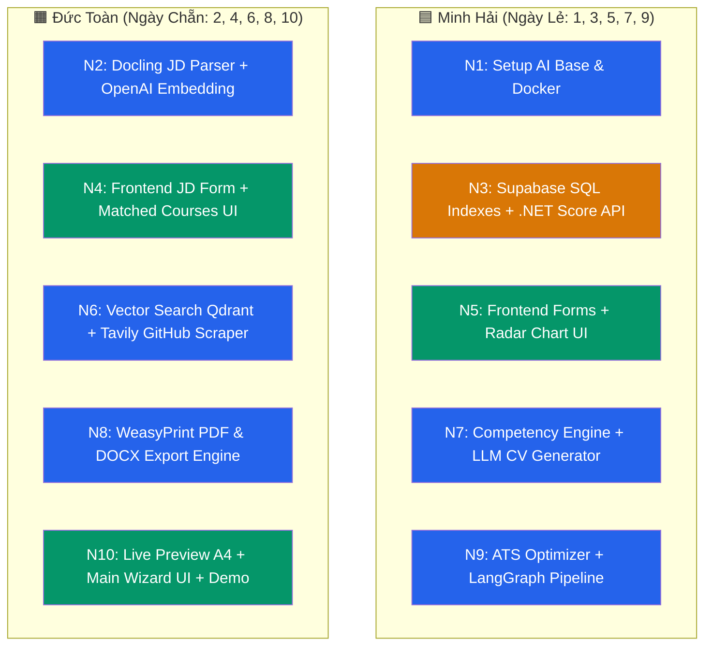

# 🗓️ Lịch Phân Công 10 Ngày Luân Phiên (Làm Cả AI + Data + FE) – Generate CV Pipeline

> **Thời gian dự án**: **Đúng 10 Ngày**  
> **Nguyên tắc tuyệt đối**: **MỖI NGÀY CHỈ DUY NHẤT 1 NGƯỜI LÀM WORKSPACE (Tỷ lệ Conflict = 0%)**  
> **Định hướng Kỹ năng**: **CẢ HAI ĐỀU THAM GIA XỬ LÝ AI, DATABASE & FRONTEND**. Phân công đan xen để cả Minh Hải và Đức Toàn đều được trải nghiệm xây dựng AI Pipeline (Docling, Embedding, Vector Search, LLM, LangGraph) lẫn Backend/Database (.NET, Supabase SQL) và Frontend React.  
> **Phân chia tổng cộng**: **Minh Hải (5 Ngày Lẻ 1, 3, 5, 7, 9)** và **Đức Toàn (5 Ngày Chẵn 2, 4, 6, 8, 10)**.

---

## 🗺️ Sơ Đồ Trải Nghiệm Công Nghệ Của Cả 2 Developer

*(Ghi chú màu: 🟦 Xanh lam = AI Service Python | 🟧 Cam = Database & Backend .NET | 🟩 Xanh lá = Frontend React)*

---

## 📅 Lịch Trình Chi Tiết 10 Ngày Luân Phiên Đan Xen Công Nghệ

---

### 🟢 NGÀY 1 (Thứ Tư): Khởi Tạo Hạ Tầng & Khung AI Service
> 👤 **Người thực hiện**: **Minh Hải 🟦** *(Mảng: AI Infrastructure)*  
> 🎯 **Mục tiêu**: Dựng khung dự án AI Service và cơ sở dữ liệu Vector Qdrant.

- **Nhiệm vụ cụ thể**:
  1. Tạo thư mục `ai-service/` với FastAPI và cấu trúc LangGraph base (`app/main.py`, `app/graph.py`).
  2. Cấu hình Docker container cho `ai-service` và `qdrant` trong `docker-compose.yml`.
  3. Kiểm thử khởi chạy container Qdrant tại port `6333` và FastAPI tại port `8000`.
- **Sản phẩm bàn giao**: Thư mục `ai-service/` chạy tốt trên Docker, Qdrant container sẵn sàng.

---

### 🟢 NGÀY 2 (Thứ Năm): Docling JD Parser, OpenAI Embedding & Seed Qdrant
> 👤 **Người thực hiện**: **Đức Toàn 🟧** *(Mảng: AI Ingestion & Vector DB)*  
> 🎯 **Mục tiêu**: Xây dựng module đọc file JD và nạp vector môn học vào Qdrant.

- **Nhiệm vụ cụ thể**:
  1. Xây dựng `jd_parser_service.py` dùng **Docling** đọc file JD (PDF/DOCX) thành markdown.
  2. Xây dựng `embedding_service.py` dùng OpenAI **`text-embedding-3-small`** (1536-dim).
  3. Viết script `ai-service/scripts/seed_vectors.py` nạp toàn bộ học phần & CLOs vào Qdrant.
- **Sản phẩm bàn giao**: API `/api/parse-jd` & `/api/embed` chạy mượt, Qdrant đã nạp dữ liệu môn học.

---

### 🟢 NGÀY 3 (Thứ Sáu): Database Index Supabase & .NET Score Query API
> 👤 **Người thực hiện**: **Minh Hải 🟦** *(Mảng: Database & Backend .NET)*  
> 🎯 **Mục tiêu**: Tối ưu database Supabase và viết API lấy điểm số sinh viên.

- **Nhiệm vụ cụ thể**:
  1. Thực thi SQL đặt 4 Critical Database Indexes trên Supabase PostgreSQL (theo [database_index_plan.md](file:///D:/CaoDangTayDo_Intern/generate_cv/generate-cv2026/docs/database_index_plan.md)).
  2. Viết `CVScoreQueryService.cs` trong Backend .NET 8 để query điểm sinh viên ≥ 7.0.
  3. Tạo endpoint API .NET: `GET /api/student/{id}/scores/filtered`.
- **Sản phẩm bàn giao**: Database Supabase đã đánh Index, API .NET lấy điểm chạy thành công.

---

### 🟢 NGÀY 4 (Thứ Bảy): Frontend JD Input & Bảng Môn Học Matched
> 👤 **Người thực hiện**: **Đức Toàn 🟧** *(Mảng: Frontend React UI)*  
> 🎯 **Mục tiêu**: Xây dựng giao diện bước 1 & 2 ở Frontend React.

- **Nhiệm vụ cụ thể**:
  1. Tạo component `JDInputForm.tsx` (hỗ trợ kéo thả file PDF/DOCX JD hoặc nhập text).
  2. Tạo component `MatchedCoursesTable.tsx` hiển thị bảng các môn học khớp kèm điểm số.
  3. Kết nối với API .NET Score Query để lấy điểm thực tế của sinh viên.
- **Sản phẩm bàn giao**: Màn hình nhập JD và hiển thị bảng điểm môn học hoạt động tốt trên UI.

---

### 🟢 NGÀY 5 (Chủ Nhật): Frontend User Forms & Skill Radar Chart
> 👤 **Người thực hiện**: **Minh Hải 🟦** *(Mảng: Frontend React UI)*  
> 🎯 **Mục tiêu**: Giao diện nhập dự án, thực tập, chứng chỉ và biểu đồ Radar kỹ năng.

- **Nhiệm vụ cụ thể**:
  1. Tạo `ProjectForm.tsx` (nhập project cá nhân + nút bấm "Auto Scrape từ GitHub").
  2. Tạo `InternshipForm.tsx` và `CertForm.tsx` (nhập kinh nghiệm thực tập & chứng chỉ).
  3. Tạo component `SkillRadarChart.tsx` (dùng Recharts trực quan hóa nhóm kỹ năng).
- **Sản phẩm bàn giao**: Bộ Form nhập liệu cá nhân đẹp mắt và biểu đồ Radar Chart hiển thị động.

---

### 🟢 NGÀY 6 (Thứ Hai): Vector Search Qdrant, Cohere Rerank & GitHub Scraper
> 👤 **Người thực hiện**: **Đức Toàn 🟧** *(Mảng: AI Search & Crawling)*  
> 🎯 **Mục tiêu**: Thuật toán tìm kiếm môn học khớp và tự động crawl dự án GitHub.

- **Nhiệm vụ cụ thể**:
  1. Xây dựng `vector_search_service.py` (Qdrant Vector Search + toggle **Cohere Rerank**).
  2. Xây dựng `project_scraper_service.py` dùng **Tavily / SERP API** để crawl thông tin từ link GitHub project.
  3. Tạo router endpoint `/api/search` & `/api/scrape-github`.
- **Sản phẩm bàn giao**: API tìm kiếm môn học đạt độ chính xác cao, API scrape GitHub lấy được README & Tech Stack.

---

### 🟢 NGÀY 7 (Thứ Ba): Competency Profile Engine & LLM CV Generator
> 👤 **Người thực hiện**: **Minh Hải 🟦** *(Mảng: AI Core & LLM)*  
> 🎯 **Mục tiêu**: Tổng hợp Competency Profile và sinh nội dung CV bằng LLM.

- **Nhiệm vụ cụ thể**:
  1. Xây dựng `competency_service.py` (Skill Matching 3 lớp + Confidence Scoring).
  2. Xây dựng `cv_generator_service.py` sử dụng **Gemma 4 (27B) / Gemini 2.5 Flash** sinh JSON CV.
  3. Tạo router endpoint `/api/competency-profile` & `/api/generate-cv`.
- **Sản phẩm bàn giao**: Engine sinh `competency_profile.json` và `cv.json` đạt chất lượng cao.

---

### 🟢 NGÀY 8 (Thứ Tư): Export PDF & DOCX Engine + HTML Templates
> 👤 **Người thực hiện**: **Đức Toàn 🟧** *(Mảng: AI Export & Templates)*  
> 🎯 **Mục tiêu**: Xây dựng module xuất file CV định dạng PDF/DOCX chuyên nghiệp.

- **Nhiệm vụ cụ thể**:
  1. Thiết kế 2 template HTML CV (`templates/modern.html`, `templates/classic.html`).
  2. Xây dựng `export_service.py` dùng **WeasyPrint** (xuất PDF) và **python-docx** (xuất DOCX).
  3. Tạo router endpoint `GET /api/export/{format}` (pdf/docx).
- **Sản phẩm bàn giao**: API xuất file trả về file PDF & DOCX căn chỉnh A4 sắc nét.

---

### 🟢 NGÀY 9 (Thứ Năm): ATS Optimizer, Evidence Validator & LangGraph Pipeline
> 👤 **Người thực hiện**: **Minh Hải 🟦** *(Mảng: AI Optimization & Orchestration)*  
> 🎯 **Mục tiêu**: Hoàn thiện tối ưu ATS, kiểm tra bằng chứng và đóng gói LangGraph Pipeline.

- **Nhiệm vụ cụ thể**:
  1. Xây dựng `ats_optimizer_service.py` (tính ATS score & gợi ý chỉnh sửa).
  2. Xây dựng `validator_service.py` (xác thực từng skill/claim có bằng chứng môn học/project).
  3. Đóng gói toàn bộ 7 bước vào LangGraph orchestrator (`app/graph.py`) với endpoint `/api/generate-cv/full`.
- **Sản phẩm bàn giao**: Full AI Pipeline hoạt động mượt mà end-to-end từ bước 1 đến bước 7.

---

### 🟢 NGÀY 10 (Thứ Sáu): Live Preview A4, Main Wizard, Testing & Polish
> 👤 **Người thực hiện**: **Đức Toàn 🟧** *(Mảng: Frontend Integration & Final Polish)*  
> 🎯 **Mục tiêu**: Hoàn thiện toàn bộ giao diện Frontend, kiểm thử tổng thể và chuẩn bị demo.

- **Nhiệm vụ cụ thể**:
  1. Tạo `CVPreview.tsx` (xem trước CV chuẩn A4 thời gian thực) + `ATSScoreBadge.tsx` + `ValidationReport.tsx`.
  2. Hoàn thiện luồng Wizard Stepper chính tại `frontend/src/pages/student/CVBuilder.tsx` nối với Real API.
  3. Kiểm thử toàn bộ hệ thống từ upload JD đến xuất file PDF.
  4. Cập nhật `README.md` dự án và đóng gói bản build Docker hoàn chỉnh.
- **Sản phẩm bàn giao**: **Dự án Generate CV hoàn chỉnh 100%**, sẵn sàng nghiệm thu & báo cáo!

---

## 📊 Bảng Phân Công Đan Xen Kỹ Năng (Quick Matrix View)

| Ngày | Người Làm | Mảng Công Nghệ | Nội Dung Chính |
|:---:|:---:|:---:|:---|
| **N1** | **Minh Hải** 🟦 | 🤖 AI Infra | FastAPI Skeleton + Docker Qdrant base |
| **N2** | **Đức Toàn** 🟧 | 🤖 AI Ingestion | Docling JD Parser + OpenAI Embedding + Seed Qdrant |
| **N3** | **Minh Hải** 🟦 | 💾 Data & .NET | Supabase SQL Indexes + .NET Score Query API |
| **N4** | **Đức Toàn** 🟧 | 🎨 Frontend | Frontend JD Input Form + Matched Courses Table UI |
| **N5** | **Minh Hải** 🟦 | 🎨 Frontend | Frontend Forms (Project/Intern/Cert) + Radar Chart |
| **N6** | **Đức Toàn** 🟧 | 🤖 AI Search | Vector Search Qdrant + Cohere Rerank + GitHub Scraper API |
| **N7** | **Minh Hải** 🟦 | 🤖 AI Core | Competency Profile Engine + LLM CV Generator (Gemma 4/Gemini) |
| **N8** | **Đức Toàn** 🟧 | 🤖 AI Export | Export Service (WeasyPrint PDF + python-docx DOCX) |
| **N9** | **Minh Hải** 🟦 | 🤖 AI Pipeline | ATS Optimizer + Evidence Validator + LangGraph Pipeline |
| **N10**| **Đức Toàn** 🟧 | 🎨 Frontend | Live Preview A4 UI + Full Wizard Flow + README & Demo |

---

## 🛡️ Quy Tắc Bàn Giao Hàng Ngày (Clean Handoff Rules)

1. **Commit & Push cuối ngày**: Đến 22:00 mỗi ngày, người làm ngày đó bắt buộc phải `git commit` và `git push` lên branch `main` (hoặc `develop`).
2. **Viết Log Bàn Giao Ngắn (3 dòng)**: Cuối mỗi ngày, nhắn nhóm 3 thông tin:
   - ✅ Hôm nay đã làm xong file/chức năng gì.
   - 📌 File/Endpoint nào sẵn sàng cho người ngày mai dùng.
   - ⚠️ Lưu ý kỹ thuật (nếu có).
3. **Tuyệt đối không code đè ngày của nhau**: Ngày lẻ chỉ Minh Hải commit, ngày chẵn chỉ Đức Toàn commit.
