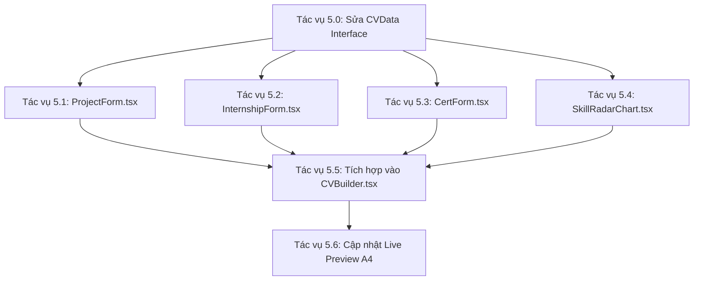

# 📋 KẾ HOẠCH CHI TIẾT NGÀY 5: FRONTEND USER FORMS & SKILL RADAR CHART (MINH HẢI)

> 👤 **Người thực hiện**: **Minh Hải** *(Mảng: Frontend React UI)*
> 📅 **Ngày làm việc**: Chủ Nhật (Ngày 5) — Ngày lẻ, đúng lịch phân công
> 🎯 **Mục tiêu**: Giao diện nhập dự án (có Auto Scrape GitHub), thực tập, chứng chỉ và biểu đồ Radar kỹ năng.

---

## 🔍 1. Phân Tích Hiện Trạng Sau Ngày 4 (Đức Toàn)

### ✅ Những gì đã hoàn thành và sẵn sàng sử dụng:

| File | Chức năng | Trạng thái |
|:-----|:----------|:-----------|
| [CVBuilder.tsx](file:///D:/CaoDangTayDo_Intern/generate_cv/generate-cv2026/frontend/src/pages/student/CVBuilder.tsx) | Wizard Stepper 2 bước (JD Match + CV Editor), Live Preview A4 | ✅ Hoạt động |
| [JDInputForm.tsx](file:///D:/CaoDangTayDo_Intern/generate_cv/generate-cv2026/frontend/src/components/JDInputForm.tsx) | Kéo thả PDF/DOCX, mẫu JD có sẵn, đọc file client-side | ✅ Hoạt động |
| [MatchedCoursesTable.tsx](file:///D:/CaoDangTayDo_Intern/generate_cv/generate-cv2026/frontend/src/components/MatchedCoursesTable.tsx) | Bảng điểm đối soát, KPI, lọc/tìm kiếm, chi tiết điểm thành phần | ✅ Hoạt động |
| [mockData.ts](file:///D:/CaoDangTayDo_Intern/generate_cv/generate-cv2026/frontend/src/mock/mockData.ts) | Interface `CVData`, dữ liệu mẫu `defaultCVData` | ✅ Sẵn sàng |
| [App.tsx](file:///D:/CaoDangTayDo_Intern/generate_cv/generate-cv2026/frontend/src/App.tsx) | Route `/student/cv` → CVBuilder | ✅ Đã đăng ký |

### ⚠️ Các vấn đề kỹ thuật cần khắc phục trước khi bắt đầu:

1. **Kiểu dữ liệu `certifications` bị sai** tại [mockData.ts dòng 410](file:///D:/CaoDangTayDo_Intern/generate_cv/generate-cv2026/frontend/src/mock/mockData.ts#L410):
   ```typescript
   // ❌ Hiện tại: khai báo là string[] nhưng thực tế lưu object[]
   certifications: string[];
   
   // ✅ Cần sửa thành:
   certifications: { certificationName: string; date: string }[];
   ```
   > Dữ liệu mẫu `defaultCVData` (dòng 435-438) đang lưu `{ certificationName, date }` nhưng interface khai báo `string[]`, dùng `as any` để né lỗi. Minh Hải cần sửa đúng kiểu để CertForm có thể thao tác an toàn.

2. **Thiếu interface `Experience`** — trường `experience` tại [dòng 411](file:///D:/CaoDangTayDo_Intern/generate_cv/generate-cv2026/frontend/src/mock/mockData.ts#L411) khai báo inline `{ company, role, period, description }[]` và là optional (`?`). Nên tạo interface rõ ràng và bổ sung dữ liệu mẫu mặc định (hiện `defaultCVData` không có trường `experience`).

3. **Các section trong CVBuilder đang thiếu**:
   - ❌ Không có form **Kinh nghiệm thực tập** (experience)
   - ❌ Không có form **Chứng chỉ** (certifications)
   - ❌ Không có **Biểu đồ Radar** kỹ năng
   - ❌ Không có nút **"Auto Scrape từ GitHub"** trong phần nhập dự án
   - ❌ Live Preview A4 **thiếu section** Kinh nghiệm thực tập và Chứng chỉ

---

## 🛠️ 2. Danh Sách Tác Vụ Chi Tiết Ngày 5



---

### 📐 Tác vụ 5.0: Sửa Interface `CVData` và bổ sung dữ liệu mẫu
**File**: [frontend/src/mock/mockData.ts](file:///D:/CaoDangTayDo_Intern/generate_cv/generate-cv2026/frontend/src/mock/mockData.ts)

**Việc cần làm**:
1. Tạo interface `Certification` và `Experience` riêng biệt:
   ```typescript
   export interface Certification {
     certificationName: string;
     date: string;
   }

   export interface Experience {
     company: string;
     role: string;
     period: string;
     description: string;
   }
   ```

2. Cập nhật interface `CVData` (dòng 404-414):
   ```diff
   export interface CVData {
     profile: Student;
     summary: string;
     skills: string[];
     languages: string[];
     projects: { name: string; description: string; role: string; technologies: string[] }[];
   -  certifications: string[];
   -  experience?: { company: string; role: string; period: string; description: string }[];
   +  certifications: Certification[];
   +  experience: Experience[];
     grades: { subjectName: string; score: number; credits: number }[];
     activities: string[];
   }
   ```

3. Bổ sung dữ liệu mẫu `experience` vào `defaultCVData` (dòng 438, trước `activities`):
   ```typescript
   experience: [
     {
       company: 'Công ty TNHH Phần mềm XYZ',
       role: 'Intern Frontend Developer',
       period: '06/2025 - 08/2025',
       description: 'Tham gia phát triển giao diện web bằng React.js, fix bug và hỗ trợ đội frontend.'
     }
   ],
   ```

4. Xóa `as any` ở dòng 438 vì kiểu dữ liệu giờ đã khớp.

> ⚡ **Đây là tác vụ đầu tiên bắt buộc** — tất cả component mới phụ thuộc vào interface này.

---

### 🛠️ Tác vụ 5.1: Tách và nâng cấp `ProjectForm.tsx`
**File mới**: `frontend/src/components/ProjectForm.tsx`

**Yêu cầu**:
1. **Trích xuất** toàn bộ logic nhập dự án hiện tại từ [CVBuilder.tsx dòng 542-603](file:///D:/CaoDangTayDo_Intern/generate_cv/generate-cv2026/frontend/src/pages/student/CVBuilder.tsx#L542-L603) ra component riêng.

2. **Props interface**:
   ```typescript
   interface ProjectFormProps {
     projects: { name: string; description: string; role: string; technologies: string[] }[];
     onAddProject: (project: { name: string; description: string; role: string; technologies: string[] }) => void;
     onRemoveProject: (index: number) => void;
   }
   ```

3. **Bổ sung trường nhập GitHub URL** + nút **"🔗 Auto Scrape từ GitHub"**:
   - Thêm ô input URL (`https://github.com/user/repo`).
   - Khi nhấn nút, gọi `axios.post('http://localhost:8000/api/scrape-github', { url })`.
   - **Xử lý Mock** (vì API Ngày 6 mới sẵn sàng): Trong khối `catch`, sau 1.5 giây tự điền dữ liệu mẫu:
     ```typescript
     // Mock fallback khi API chưa sẵn sàng
     setTimeout(() => {
       setNewProject({
         name: 'E-Commerce Portal',
         role: 'Full-stack Developer',
         description: 'Hệ thống mua sắm trực tuyến với giỏ hàng, thanh toán và quản lý đơn hàng.',
         technologies: 'React, Node.js, PostgreSQL, Docker'
       });
       setIsScraping(false);
     }, 1500);
     ```
   - Hiển thị trạng thái loading (spinner) khi đang scrape.

4. **Icon**: Sử dụng `GithubLogo` từ `@phosphor-icons/react` cho nút scrape.

---

### 🛠️ Tác vụ 5.2: Xây dựng `InternshipForm.tsx`
**File mới**: `frontend/src/components/InternshipForm.tsx`

**Yêu cầu**:
1. **Props interface**:
   ```typescript
   interface InternshipFormProps {
     experiences: Experience[];
     onAddExperience: (exp: Experience) => void;
     onRemoveExperience: (index: number) => void;
   }
   ```

2. **Giao diện form** gồm 4 trường:
   | Trường | Placeholder | Kiểu |
   |:-------|:-----------|:-----|
   | Tên công ty | `"Công ty TNHH ABC..."` | `input text` |
   | Vai trò | `"Intern Frontend Developer..."` | `input text` |
   | Khoảng thời gian | `"06/2025 - 08/2025"` | `input text` |
   | Mô tả công việc | `"Mô tả công việc thực tập..."` | `textarea rows={2}` |

3. **Render danh sách** kinh nghiệm đã thêm dưới dạng card gọn với nút xóa (icon `Trash`).

4. **Icon tiêu đề section**: Sử dụng `Briefcase` từ `@phosphor-icons/react`.

---

### 🛠️ Tác vụ 5.3: Xây dựng `CertForm.tsx`
**File mới**: `frontend/src/components/CertForm.tsx`

**Yêu cầu**:
1. **Props interface**:
   ```typescript
   interface CertFormProps {
     certifications: Certification[];
     onAddCert: (cert: Certification) => void;
     onRemoveCert: (index: number) => void;
   }
   ```

2. **Giao diện form** gồm 2 trường trên 1 hàng (grid 2 cột):
   | Trường | Placeholder | Kiểu |
   |:-------|:-----------|:-----|
   | Tên chứng chỉ | `"Chứng chỉ Lập trình Web Full-stack (F8)"` | `input text` |
   | Năm đạt được | `"2025"` | `input text` |

3. **Render danh sách** chứng chỉ dưới dạng tag/badge với nút xóa.

4. **Icon tiêu đề section**: Sử dụng `Certificate` từ `@phosphor-icons/react`.

---

### 📊 Tác vụ 5.4: Phát triển `SkillRadarChart.tsx`
**File mới**: `frontend/src/components/SkillRadarChart.tsx`

**Yêu cầu**:

1. **Props interface**:
   ```typescript
   interface SkillRadarChartProps {
     grades: { subjectName: string; score: number; credits: number }[];
     selectedGrades: string[];
   }
   ```

2. **Thư viện**: Sử dụng `Radar`, `RadarChart`, `PolarGrid`, `PolarAngleAxis`, `PolarRadiusAxis`, `ResponsiveContainer` từ **Recharts** (đã cài sẵn trong [package.json dòng 19](file:///D:/CaoDangTayDo_Intern/generate_cv/generate-cv2026/frontend/package.json#L19): `"recharts": "^3.9.2"`).

3. **Logic phân nhóm kỹ năng động** (QUAN TRỌNG — tránh hardcode):
   ```typescript
   const SKILL_GROUPS: Record<string, string[]> = {
     'Lập trình Web': ['lập trình web', 'web nâng cao', 'giao diện', 'frontend'],
     'Lập trình C/C#': ['lập trình c', 'c#', '.net', 'kỹ thuật lập trình'],
     'Cơ sở dữ liệu': ['cơ sở dữ liệu', 'sql', 'database'],
     'Phân tích & Thiết kế': ['phân tích', 'thiết kế hệ thống', 'kỹ thuật phần mềm'],
     'Mạng & Bảo mật': ['mạng', 'bảo mật', 'an toàn thông tin'],
   };
   ```
   - Lọc các môn học có trong `selectedGrades` → phân vào nhóm dựa trên tên môn (toLowerCase + includes).
   - Tính **điểm trung bình cộng** của mỗi nhóm → giá trị vẽ biểu đồ.
   - Nhóm nào không có môn nào được chọn → giá trị = 0.
   - Kết quả: biểu đồ Radar **tự thay đổi hình dáng** khi sinh viên tích/bỏ tích môn học ở Bước 1!

4. **Thẩm mỹ giao diện**:
   - Stroke màu accent: `#22C55E`, fill: `rgba(34, 197, 94, 0.25)`.
   - Grid: `stroke: rgba(51, 65, 85, 0.5)`.
   - Label text: `fill: '#F8FAFC'`, `fontSize: 12`.
   - Khung bao: `background: rgba(15, 23, 42, 0.6)`, `border: 1px solid var(--color-border)`, `borderRadius: 10px`.
   - Hiển thị tiêu đề "📊 Biểu Đồ Năng Lực Chuyên Môn" phía trên biểu đồ.
   - Hiển thị thông báo "*Dữ liệu tính toán từ điểm thực tế các môn học đã chọn*" bên dưới.

---

### 🎨 Tác vụ 5.5: Tích hợp các Component mới vào `CVBuilder.tsx`
**File**: [frontend/src/pages/student/CVBuilder.tsx](file:///D:/CaoDangTayDo_Intern/generate_cv/generate-cv2026/frontend/src/pages/student/CVBuilder.tsx)

**Việc cần làm**:

1. **Import** 4 component mới ở đầu file:
   ```typescript
   import { ProjectForm } from '../../components/ProjectForm';
   import { InternshipForm } from '../../components/InternshipForm';
   import { CertForm } from '../../components/CertForm';
   import { SkillRadarChart } from '../../components/SkillRadarChart';
   ```

2. **Thêm state** cho experience và certifications (bên cạnh các state hiện có):
   ```typescript
   // Handlers cho experience
   const handleAddExperience = (exp: Experience) => {
     setCvData(prev => ({ ...prev, experience: [...prev.experience, exp] }));
   };
   const handleRemoveExperience = (index: number) => {
     setCvData(prev => ({ ...prev, experience: prev.experience.filter((_, i) => i !== index) }));
   };

   // Handlers cho certifications
   const handleAddCert = (cert: Certification) => {
     setCvData(prev => ({ ...prev, certifications: [...prev.certifications, cert] }));
   };
   const handleRemoveCert = (index: number) => {
     setCvData(prev => ({ ...prev, certifications: prev.certifications.filter((_, i) => i !== index) }));
   };
   ```

3. **Thay thế** Section 5 inline (dòng 542-603) bằng:
   ```tsx
   <ProjectForm
     projects={cvData.projects}
     onAddProject={handleAddProject}
     onRemoveProject={handleRemoveProject}
   />
   ```

4. **Chèn thêm** các section mới giữa Section 5 (Projects) và Section 6 (Grades):
   ```tsx
   {/* Section 5b: Kinh nghiệm thực tập */}
   <InternshipForm
     experiences={cvData.experience}
     onAddExperience={handleAddExperience}
     onRemoveExperience={handleRemoveExperience}
   />

   {/* Section 5c: Chứng chỉ */}
   <CertForm
     certifications={cvData.certifications}
     onAddCert={handleAddCert}
     onRemoveCert={handleRemoveCert}
   />
   ```

5. **Chèn SkillRadarChart** sau Section 6 (Grades) và trước Section 7 (Activities):
   ```tsx
   {/* Section 6b: Biểu đồ Radar năng lực */}
   <SkillRadarChart
     grades={cvData.grades}
     selectedGrades={selectedGrades}
   />
   ```

6. **Đánh lại số section** sau khi chèn (1→ Thông tin cá nhân, 2→ Giới thiệu, 3→ Kỹ năng, 4→ Ngoại ngữ, 5→ Dự án, 6→ Thực tập, 7→ Chứng chỉ, 8→ Môn học matched, 9→ Biểu đồ Radar, 10→ Hoạt động ngoại khóa).

---

### 🖨️ Tác vụ 5.6: Cập nhật Live Preview A4
**File**: [CVBuilder.tsx — phần `cv-preview` dòng 671-764](file:///D:/CaoDangTayDo_Intern/generate_cv/generate-cv2026/frontend/src/pages/student/CVBuilder.tsx#L671-L764)

Phần xem trước A4 hiện tại **thiếu 2 section**: Kinh nghiệm thực tập và Chứng chỉ. Cần bổ sung:

1. **Sau section "Dự án đã thực hiện" (dòng 730)**, thêm section Kinh nghiệm:
   ```tsx
   {/* Internship / Experience */}
   {cvData.experience && cvData.experience.length > 0 && (
     <div className="cv-pdf-section">
       <div className="cv-pdf-section-title">Kinh nghiệm thực tập</div>
       {cvData.experience.map((exp, idx) => (
         <div key={idx} style={{ marginBottom: '8px' }}>
           <div style={{ fontWeight: 600, fontSize: '0.85rem' }}>{exp.company}</div>
           <div style={{ fontSize: '0.75rem', color: '#475569' }}>
             {exp.role} | {exp.period}
           </div>
           <p style={{ fontSize: '0.75rem', color: '#475569', marginTop: '2px' }}>
             {exp.description}
           </p>
         </div>
       ))}
     </div>
   )}
   ```

2. **Sau section Kinh nghiệm**, thêm section Chứng chỉ:
   ```tsx
   {/* Certifications */}
   {cvData.certifications && cvData.certifications.length > 0 && (
     <div className="cv-pdf-section">
       <div className="cv-pdf-section-title">Chứng chỉ</div>
       <div style={{ display: 'flex', flexWrap: 'wrap', gap: '6px', marginTop: '4px' }}>
         {cvData.certifications.map((cert, idx) => (
           <span key={idx} className="cv-tag">
             {cert.certificationName} ({cert.date})
           </span>
         ))}
       </div>
     </div>
   )}
   ```

---

## 📋 3. Checklist Kiểm Tra Trước Khi Bàn Giao

| # | Hạng mục | Kiểm tra |
|:--|:---------|:---------|
| 1 | Interface `CVData` sửa đúng kiểu `certifications` và `experience` | ☐ |
| 2 | `ProjectForm.tsx` tách riêng, có nút Auto Scrape GitHub (mock fallback) | ☐ |
| 3 | `InternshipForm.tsx` thêm/xóa kinh nghiệm thực tập hoạt động | ☐ |
| 4 | `CertForm.tsx` thêm/xóa chứng chỉ hoạt động | ☐ |
| 5 | `SkillRadarChart.tsx` hiển thị biểu đồ Radar động theo môn học đã chọn | ☐ |
| 6 | `CVBuilder.tsx` import và nhúng đủ 4 component mới | ☐ |
| 7 | Live Preview A4 hiển thị Kinh nghiệm thực tập + Chứng chỉ | ☐ |
| 8 | Không có lỗi TypeScript / console error | ☐ |
| 9 | Giao diện responsive, đẹp mắt theo design system (dark theme, accent #22C55E) | ☐ |

---

## 🛡️ 4. Quy Tắc Bàn Giao Cuối Ngày 5
* **Branch**: `minhhai` (sau đó tạo PR vào `develop`).
* **Thời hạn push code**: Trước **22:00 Chủ Nhật (Ngày 5)**.
* **Mẫu Log Bàn Giao 3 Dòng**:
  ```
  ✅ Hoàn thành: Sửa CVData interface, tách ProjectForm (có Mock GitHub Scrape), thêm InternshipForm, CertForm, SkillRadarChart. Cập nhật Live Preview A4.
  📌 Sẵn sàng: 4 component mới đã kết nối cvData. API /api/scrape-github ở Ngày 6 chỉ cần gọi thay Mock. Recharts Radar Chart tự cập nhật theo môn học.
  ⚠️ Lưu ý cho Đức Toàn (Ngày 6): API /api/scrape-github cần trả về JSON { name, description, technologies[] }. Kiểm tra null/undefined khi tính GPA trung bình nhóm môn học.
  ```

---

## 📌 5. Lưu Ý Kỹ Thuật Quan Trọng

> [!WARNING]
> **Recharts RadarChart** yêu cầu giá trị `value` là số thực hợp lệ (không phải `null`, `undefined` hay `NaN`). Khi tính điểm GPA trung bình nhóm, nhớ kiểm tra mảng rỗng trước khi chia:
> ```typescript
> const avg = items.length > 0 ? items.reduce((s, g) => s + g.score, 0) / items.length : 0;
> ```

> [!IMPORTANT]
> **Thứ tự file cần sửa/tạo**:
> 1. `mockData.ts` (sửa interface + data) → bắt buộc làm trước
> 2. `ProjectForm.tsx` → tạo mới
> 3. `InternshipForm.tsx` → tạo mới
> 4. `CertForm.tsx` → tạo mới
> 5. `SkillRadarChart.tsx` → tạo mới
> 6. `CVBuilder.tsx` → import + tích hợp + cập nhật Live Preview
